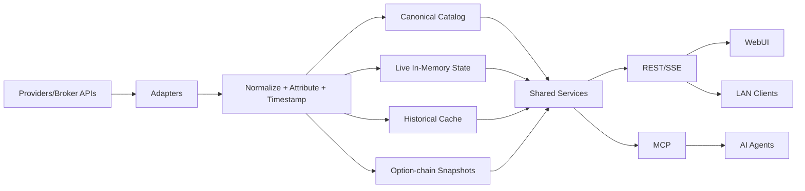
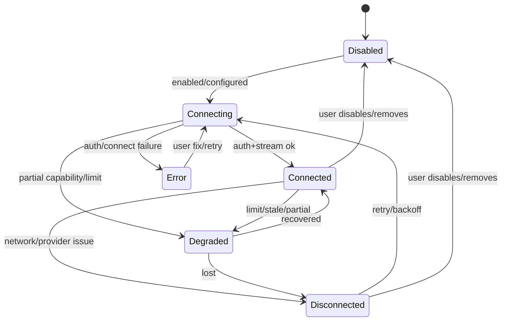
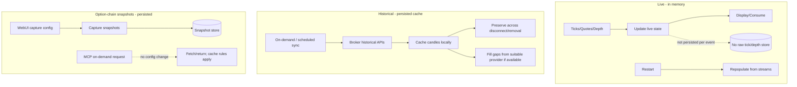
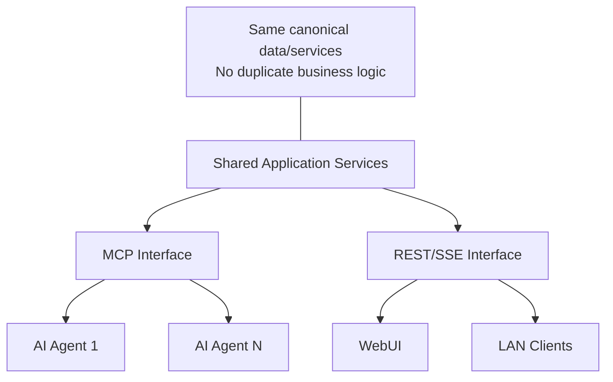
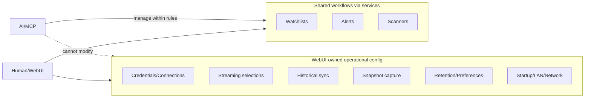
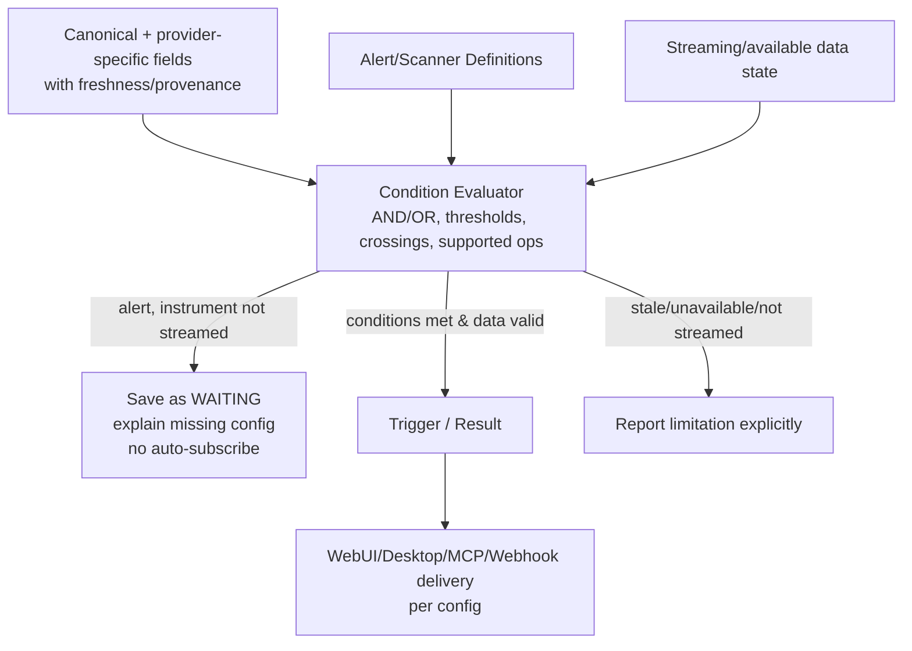

# Architecture

> **Status:** Target architecture and current implementation mapping (authoritative design baseline). Items marked **(planned)** or **(verify)** are not implemented/confirmed.
> **Last updated:** 2026-11-17
> **Related:** [ENGINEERING_STANDARDS.md](ENGINEERING_STANDARDS.md) (canonical), [ARCHITECTURE_DECISIONS.md](ARCHITECTURE_DECISIONS.md), [MULTI_PROVIDER_STREAMING_ARCHITECTURE.md](MULTI_PROVIDER_STREAMING_ARCHITECTURE.md) (proposed target design), [MARKET_DATA_AND_CATALOG.md](MARKET_DATA_AND_CATALOG.md), [PROVIDER_INTEGRATION.md](PROVIDER_INTEGRATION.md), [MCP_INTERFACE.md](MCP_INTERFACE.md), [WEBUI_AND_CONFIGURATION.md](WEBUI_AND_CONFIGURATION.md), [DATA_LIFECYCLE_AND_STORAGE.md](DATA_LIFECYCLE_AND_STORAGE.md), [PROJECT_STATUS.md](PROJECT_STATUS.md)

## 1. System overview

MarketHubTS is the **only intended future MarketHub application** (clean, independent TypeScript solution; original Python MarketHub is reference for domain knowledge/useful requirements only). It is a **Windows-first, local-first** Indian stock-market data platform (NSE/BSE F&O focus) running as a **single local owner/application instance** on the user’s PC. **Single-user means one local application owner, not one connected client.**

It collects, normalizes, organizes, maintains, and exposes market data through a **single canonical data and application-services foundation** consumed by **MCP** (AI agents/applications) and **REST/SSE + WebUI** (humans, devices, and LAN clients). **LAN access is required** so other applications, devices, and multiple MCP clients can connect to the same running application. Local browser-based WebUI is acceptable; a native desktop wrapper is optional (do not prematurely force either). No cloud hosting, no public internet exposure, no application-level login/authentication. LAN reachability and the single-owner model do not by themselves establish that every LAN client is trusted or authorized for every operation; safe exposure boundaries for sensitive data and operations must be defined and reviewed (without introducing an application-level login system or changing confirmed product scope).

**Current state:** M1 runtime foundation, M2 canonical catalog/persistence/sync, M3 provider adapter framework, M4 Stages A/B/C/D/E/F and the M5 offline implementation (Phases 1–4A) are published on `develop`; M6-A, M6-B1, M6-B2 and M6-B3 are implemented and published, and M6-C is accepted and closed at `32b034a`. M6-D/E source and tests are present but neither phase is accepted; M6-B4 remains separately owned. Stage D delivers the provider-ready live-data backend: canonical live service notifications, bounded realtime hub, subscription persistence with durable generation, supervisor, REST/SSE market endpoints, and a locked production driver boundary. Stage E delivers the WebUI live-data experience: streaming selections, canonical-field-only live views, and a deterministic named-event SSE client with recovery and refresh. M5 adds offline historical candle and option-chain snapshot persistence with local API/WebUI panels. No live provider connection is attempted and no real feed has been tested; watchlists/alerts/scanners, charts, backup/restore and News/X/Twitter remain unimplemented. See [PROJECT_STATUS.md](PROJECT_STATUS.md) for the verified state.

**Engineering approach:** modular monolith with clear module boundaries, defined interfaces/contracts, fault containment, and bounded resources per [ENGINEERING_STANDARDS.md](ENGINEERING_STANDARDS.md) (not microservices; no claim of absolute isolation in a shared process).

**Development and verification approach:** evidence-driven and research-first (official docs, supported versions, actual compatibility). Build the real MarketHubTS application in controlled phases; verify/test actual components as implemented and integrate progressively. The first meaningful end-to-end vertical slice must prove one complete market-data flow through the actual application and its consumers (not a discarded demonstration). Start with a limited initial instrument set while designing for full intended catalogue expansion; never hardcode changing exchange information. When a significant uncertainty cannot be resolved through research, use only a narrowly scoped, proportionate experiment and reuse results in the actual product where practical. See [PROJECT_MANAGER_PROTOCOL.md](PROJECT_MANAGER_PROTOCOL.md) and [IMPLEMENTATION_ROADMAP.md](IMPLEMENTATION_ROADMAP.md).

## 2. Logical architecture diagram

```mermaid
flowchart TB
  subgraph Providers[Market Data Providers]
    U[Upstox]
    F[FYERS]
    N[Non-broker sources\nreports/calendars/status\n(verify availability)]
  end

  subgraph Adapters[Provider Adapters - isolated]
    UA[Upstox Adapter]
    FA[FYERS Adapter]
  end

  subgraph Core[Canonical Foundation - single source of truth]
    CAT[Common Instrument Catalog]
    NORM[Normalization & Provenance]
    LIVE[In-memory Live State\nquotes/depth/ticks]
    HIST[Historical Cache & Retrieval]
    SNAP[Option-chain Snapshot Store]
    SEL[Source Selection\ncapability/freshness/reliability/limits]
  end

  subgraph Services[Shared Application Services]
    MKT[Market Data Service]
    WL[Watchlists]
    ALT[Alerts]
    SCN[Scanners]
    CFG[Operational Config\nWebUI-owned]
    DIAG[Diagnostics/Health]
  end

  subgraph Interfaces[Consumer Interfaces]
    MCP[MCP Server\nStreamable HTTP + SSE events (mandatory M6 deliverable)\nSTDIO (retained for compatibility)]
    API[REST + SSE]
    UI[WebUI]
  end

  subgraph Clients[Clients]
    AI[AI Agents]
    HUM[Humans / LAN devices]
  end

  U --> UA --> NORM
  F --> FA --> NORM
  N --> MKT
  NORM --> CAT
  NORM --> LIVE
  NORM --> HIST
  NORM --> SNAP
  SEL --> MKT
  CAT --> MKT
  LIVE --> MKT
  HIST --> MKT
  SNAP --> MKT
  MKT --> WL
  MKT --> ALT
  MKT --> SCN
  CFG --> Services
  Services --> MCP
  Services --> API
  API --> UI
  MCP --> AI
  UI --> HUM
  API --> HUM
```

## 3. Main subsystem responsibilities

| Subsystem | Responsibility (planned unless noted) | Current state |
|---|---|---|
| Provider adapters (`packages/broker-upstox`, `broker-fyers`) | Auth/token lifecycle, REST/WS connections, subscriptions, reconnect, rate/subscription limits, health/error reporting, normalization input | **Implemented (M3 auth; M4-B Upstox stream):** Upstox Analytics Token REST validation and V3 SDK streaming adapter; FYERS V3 non-trading OAuth with loopback callback. Stage D production uses a locked driver; no real socket is opened. |
| Canonical catalog & identity (`packages/market-core`, `packages/contracts`) | Canonical instrument/contract identity, mappings, aliases, lifecycle, transactional sync, validation | **Implemented (M2):** contracts, normalized identity keys, sync service, repository ports; not yet fed by real providers |
| Normalization/provenance | Stable canonical fields + preserved provider-specific fields, attribution, timestamps, freshness/availability | **Implemented (M4-A/B):** canonical observation normalization, provenance, session-aware freshness; Upstox feed translation in adapter |
| Source selection | Automatic choice by capability/availability/freshness/reliability/limits; optional manual preferences (WebUI) | **Implemented (M4-A):** deterministic selection over per-provider observations and connection state |
| Live state | In-memory ticks/quotes/depth for display/consumption; repopulated from streams on restart | **Implemented (M4-A/D):** bounded `LiveStateStore` with monotonic revision, consistent snapshots, synchronous change notifications |
| Historical service | On-demand retrieval, user-configured sync, local candle cache, gap fill from suitable provider, clear unavailability | **Implemented (M5 offline, Phases 1–4A):** five-table persistence, derived coverage, first-write-wins conflicts, fail-closed retention, local API/WebUI; provider-backed activation remains Stage-G gated |
| Option-chain snapshots | Persistent snapshots per WebUI capture config (underlying/expiry/strikes/capture/streaming independent) | **Implemented (M5 offline, Phases 1–4A):** canonical envelope, WebUI-owned capture config, on-demand immutability, deletion safety; provider-backed capture remains Stage-G gated |
| Shared services | Market data, watchlists, alerts, scanners, config, diagnostics — single implementation for all consumers | **Market data + health/status foundation**; watchlists/alerts/scanners pending |
| MCP (`apps/api` HTTP `/mcp`, `apps/mcp-server` STDIO, `packages/mcp-core` shared registration) | AI-facing tools/resources/events over shared services; no separate market logic | **Implemented (M6-A/B1/B2):** Streamable HTTP at `/mcp` + retained STDIO, one shared factory, nine tools, catalog-search and event-feed read seams with runtime-scoped cursors; resources/prompts and snapshot pagination (B3) implemented and published on `develop` at `0d58bbb`; activity history (M6-C) accepted and closed at `32b034a`; M6-D/E source and tests present, formal acceptance pending |
| REST/SSE (`apps/api`) | Human/UI and programmatic access over shared services; SSE for realtime/events | **Implemented (M4-D):** `/api/market/snapshot`, `/api/market/stream` (SSE), `/api/market/subscriptions` (GET/PUT, local-owner-only), plus health/status foundation |
| WebUI (`apps/web`) | Human interface and operational control centre | System-status shell (real backend/runtime status) plus Stage E live-data tab: streaming selections and canonical-field-only live views with explicit locked/unavailable/stale/error states |
| Database (`packages/database`) | SQLite persistence, migrations, WAL, controlled writes, backup/restore support | **Implemented foundation + M2 catalog + M4-D subscriptions + M5 historical/snapshot + M6-C activity:** `app_meta`, catalog tables, `streaming_subscriptions` with durable generation, five M5 tables, `mcp_activity`; migrations `0000`–`0006` |
| Realtime/analytics (`packages/realtime`, `analytics`) | Bounded event delivery, derived indicators/analytics (separately labelled) | **Realtime hub implemented (M4-D):** bounded replay/per-client queues, drop counters, coalesced `snapshot-required`, `refresh`; analytics placeholder |
## 4. Provider-adapter boundary

- All provider-specific protocols, auth, identifiers, field names, limits, and quirks remain inside adapters.
- Adapters emit normalized records + provider-native details/attribution into canonical foundation.
- No adapter logic in MCP, WebUI, or shared service consumers.
- Adapters are independently connectable/disconnectable/removable; failure of one must not break others.
- **M3 implementation:** Upstox uses the read-only Analytics Token (validated via `GET /v2/market/status/NSE`); FYERS uses V3 individual-app OAuth with a non-trading (data-only) app and a loopback callback. REST via Bun native `fetch`. Provider state distinguishes disabled / not configured / auth required / authenticated (REST validated) / expired or revoked / degraded / error. Credential-changing routes are on the main app behind a single local-peer check; no separate management server or CSRF framework. No app-level login is introduced. See [PROVIDER_INTEGRATION.md](PROVIDER_INTEGRATION.md) and AD-021/AD-022.
- **M4-B/C streaming adapters:** the Upstox V3 SDK (`upstox-js-sdk@2.31.0`, pinned) and the FYERS Data Socket SDK (`fyers-api-v3@2.4.1`, pinned, M4 Stage C) are used for market-data streaming only; SDK types and protocol stay behind each adapter seam and emit canonical `NormalizeObservationInput` / `ComponentUpdate` values.
- **M4-D locked production boundary:** the supervisor is provider-agnostic and consumes a small streaming-driver interface. Production composition uses `LockedUpstoxDriver`, which fails safely on any `start`/`updateSubscriptions` attempt and never constructs the SDK, opens a socket, or schedules retries. Real driver construction is unreachable through startup, API and config paths; only a separately authorized, independently reviewed Stage G change may unlock it. Runtime connection state is owned by the supervisor and written through `MarketDataService`; `ProviderRegistry` retains auth/status ownership, and the API composes both for `/api/providers/status`.

**Implemented provider architecture (AD-024 foundation).** The description above is the **implemented** design: one shared `SubscriptionCoordinator` with independent per-provider runtimes, a canonical data-component model with per-component source selection, and provider-neutral capability contracts — documented in [MULTI_PROVIDER_STREAMING_ARCHITECTURE.md](MULTI_PROVIDER_STREAMING_ARCHITECTURE.md) and recorded as **AD-024** (the decision record's formal status remains pending owner closeout; the shared foundation is implemented on `develop`). The component model prevents partial FYERS price/depth messages from overwriting each other; the Stage C adapter adds adapter-side depth protection on top of it. This does not unlock the production boundary or authorize live verification (Stage G).

## 5. Canonical catalog and identity architecture

- **Canonical identity** is distinct from provider-native identifiers; mappings and aliases maintained per instrument/contract.
- Covers exchange/segment, underlying, contract identity (expiry/strike/option type), lot/tick/quantity freeze (where applicable), active/expired status, sync metadata.
- Shared by all modules/consumers (Dashboard, Market data, Watchlists, Charts, Options, Futures, Alerts, Scanners, Historical, REST, MCP).
- **Transactional, safe sync:** failed/incomplete sync must never destroy previous valid catalog.
- Dynamic evolution for introduced/modified/expired/excluded/removed contracts; no permanent hardcoding of changing exchange data.

## 6. Source-selection responsibilities

- **Default automatic:** choose source using actual capability, data availability, freshness, reliability, and subscription/account limits.
- **Optional manual preferences:** advanced WebUI setting; no fixed Upstox-first/FYERS-first dependency.
- Preserve and expose source/provider attribution and timestamps for selected and available data.
- When no suitable provider/source available, report unavailable/stale state clearly (never fabricate).

## 7. Subscription and streaming configuration

- **WebUI-owned operational config:** streaming selections, historical sync selections/schedules, option-chain snapshot capture/streaming selections, provider enable/disable/preferences.
- **MCP/AI:** may perform one-time on-demand retrieval without silently modifying saved operational settings; must not change streaming/sync/capture/retention/provider/connection/startup/network config.
- Alerts/scanners must not silently subscribe to additional instruments; alerts requiring non-streamed instruments saved as **waiting for streaming** with explanation.

## 8. In-memory live data architecture

- Live ticks, quotes, and market-depth updates kept **in memory** for display/consumption.
- **Do not** permanently store every incoming tick or every market-depth change.
- Repopulated from connected provider streams after restart.
- Every live item carries source, timestamp, and freshness/availability state.
- Bounded structures/backpressure prevent unbounded memory/queue growth. **Implemented (M4-D):** `LiveEventHub` bounds replay history and per-client queues by event count and approximate bytes; overflow drops data events, increments drop counters and emits one coalesced `snapshot-required` control event while retaining the subscriber. Control events (`snapshot-required`, `refresh`) carry no data revision and never advance it.

## 9. Historical persistence and cache architecture

- Historical candles retrieved via connected broker historical APIs (on request and/or user-configured sync).
- Successfully retrieved candles cached locally; preserved across broker disconnect/removal.
- Missing periods may be retrieved from another suitable provider when available; unavailable periods/provider restrictions reported clearly.
- Do not duplicate entire broker historical databases without demonstrated requirement.
- Retention user-controlled via WebUI.

## 10. Option-chain snapshot architecture

- **Separate persistent storage strategy** from live in-memory state and from generic candle cache.
- Captured locally per WebUI configuration: underlying, expiry, all strikes or selected ranges, capture/snapshot selection; streaming selection independent of snapshot capture.
- No claims of snapshots before local collection began unless provider actually supplies that historical information (verify).
- MCP one-time option-chain requests do not alter saved snapshot-capture configuration.

## 11. Alert and scanner architecture

- Distinct services sharing condition-definition infrastructure where appropriate; both use shared canonical/provider-field data and services.
- **Alerts:** definitions/trigger history shared across MCP and WebUI; states include waiting/active/unavailable/triggered; delivery via WebUI notifications/history, desktop notifications, MCP events, webhooks (configurable).
- **Alert-event delivery (MCP-compatible target, verify):** persist durable trigger records/history with stable event IDs and monotonic sequence/cursor metadata; expose discoverable alert-event resources/feeds via shared services; use supported MCP 2026-07-28 `subscriptions/listen` notifications (e.g. `notifications/resources/updated`, list changes as applicable) as read-after-notify signals; clients retrieve events by cursor/sequence, recover after reconnect from durable history, and consume independently (multi-client isolation). Polling/tool retrieval is a fallback for clients without required subscription capability. Do not invent arbitrary alert-trigger notification types.
- **Scanners:** manual, scheduled, continuous evaluation from incoming live data (configurable); results must identify stale/unavailable/not-streamed limitations.
- Neither silently subscribes to additional instruments.

## 12. MCP service and transport architecture

- MCP is a primary interface backed by **shared application services** (no separate market calculations).
- **Transports (verified against current official MCP spec/SDK):** **Streamable HTTP is the primary network transport and a mandatory M6 deliverable** — it must be fully implemented and working at `/mcp` on the existing Hono/Bun app over localhost with real HTTP integration, subject to Host/Origin security (M6-A), with the existing LAN configuration/binding and Host/Origin security implementation retained. Physical second-device LAN verification is outside the revised M6 scope by explicit user decision; physical reachability is not verified and the in-process simulation is not proof of it. It is not optional or deferrable, and M6 cannot be declared complete without real-HTTP integration acceptance (M6-E). SSE-based event/subscription delivery under the current spec (including supported `subscriptions/listen` notifications such as `resources/updated` / list changes where applicable, read-after-notify, cursor/reconnect handling and multi-client isolation) is delivered **inside** Streamable HTTP (M6-D). **The deprecated legacy HTTP+SSE transport must not be implemented.** STDIO is retained for compatibility but is not a substitute for the HTTP transport. See [M6_PLAN.md](M6_PLAN.md) §1/§10–§12 and [MCP_INTERFACE.md](MCP_INTERFACE.md) §3.
- **Alert/event delivery mechanism (target, verify):** durable MarketHub event records + discoverable resources/feeds + supported protocol notifications with read-after-notify, event IDs/cursors/sequence, reconnect recovery, independent multi-client consumption, and polling/tool fallback (see [MCP_INTERFACE.md](MCP_INTERFACE.md)).
- Multiple simultaneous MCP clients; shared canonical data/services; one client’s subscriptions/disconnection must not corrupt another’s operation.
- **Protocol target (mandatory product requirement):** MarketHub must support the **latest stable official MCP protocol**, not merely a working HTTP endpoint. Verified target `2026-07-28` / TypeScript SDK `2.4.0` (2026-11-19); re-verify at implementation start and retarget if a newer stable version exists. The complete mandatory server-side conformance matrix (C1–C21), optional-extension decisions and modern-vs-legacy policy are in [M6_PLAN.md](M6_PLAN.md) §3.1–§3.3. Modern behavior is mandatory; older compatibility is retained only where justified and tested. No deprecated feature (legacy HTTP+SSE, Roots, Sampling, Logging) is used for new functionality, and no unsupported extension is advertised. **M6 is not complete until the target revision's mandatory requirements are verified, Streamable HTTP works, and conformance tests pass.**
- **Current implementation (M6-A/B1/B2):** Streamable HTTP at `/mcp` on the existing Hono app (`createMcpHandler`, Host/Origin validation, before SPA fallback) plus retained STDIO (`serveStdio`), both using one shared factory in `packages/mcp-core`. Nine tools are registered over both transports; catalog-search and event-feed read seams (with runtime-scoped cursors and always-present `resumeCursor`) are implemented. Resources/prompts and snapshot pagination (B3) are implemented and published on `develop` at `0d58bbb`; activity history (M6-C) is accepted and closed at `32b034a`; M6-D/E source and tests are present but neither phase is formally accepted (independent review gate in [M6_D_E_PLAN.md](M6_D_E_PLAN.md) §8.1–§8.3).

## 13. REST/SSE delivery architecture

- REST endpoints and SSE streams expose shared services/data to WebUI and LAN clients. **Implemented (M4-D):** `GET /api/market/snapshot` (Zod-validated canonical snapshot), `GET /api/market/stream` (SSE), `GET/PUT /api/market/subscriptions` (PUT local-owner-only via the existing local-peer check).
- SSE is the frontend realtime transport with bounded per-client buffers, cleanup, observable drop counters and graceful shutdown. **Implemented (M4-D):** compact revisioned events (`item-updated`, `item-removed`, `provider-connection-changed`), initial `snapshot` for synchronization, and control events (`snapshot-required`, `refresh`). Cursor precedence: `Last-Event-ID` is authoritative when present (empty-but-present is invalid); `?since=` is used only when the header is absent; invalid/future/expired cursors emit one `snapshot-required` and terminate the stream. Recovery is a client close → REST snapshot fetch → reconnect with `?since=` sequence, implemented and accepted in Stage E.
- **Reliability rule:** when a subscriber queue overflows, **drop overflowing events, not the subscriber**.
- WebSocket only if a real requirement justifies it (planned/verify).

## 14. WebUI architecture

- Human-facing interface and **operational control centre** (owns all operational configuration).
- Consumes REST/SSE backed by shared services; customizable dashboard/layout/panels/modules/tables/sorting/filters/saved layouts/watchlists/charts.
- Charts (Vela candidate, compatibility pending): candlestick, OHLC/volume, historical candles, multiple timeframes, indicators, drawing tools for stocks/indices/futures/options; backend remains source of truth for market data/candles.

## 15. Configuration ownership

| Area | Owner | AI/MCP may modify? |
|---|---|---|
| Broker credentials/config, provider connections/enable/disable | WebUI | No |
| Streaming selections | WebUI | No |
| Historical sync selections/schedules | WebUI | No |
| Option-chain snapshot capture config | WebUI | No |
| Data retention | WebUI | No |
| Provider selection preferences | WebUI | No |
| Startup/background, LAN/app address/network config | WebUI | No |
| Watchlists, alert definitions, scanner definitions/execution requests (within rules) | MCP and/or WebUI via shared services | Yes (permitted workflow actions only) |
| On-demand data retrieval (no saved-setting mutation) | MCP | Yes (read/fetch action, not config change) |

## 16. Database responsibilities

- SQLite (`bun:sqlite`) + Drizzle; local single-user, WAL, controlled writes/transactions, prepared statements (planned), batched persistence where appropriate.
- **Implemented (M1/M2/M4-D):** `app_meta` and catalog persistence (`canonical_instruments`, `provider_instrument_mappings`, `instrument_aliases`, `instrument_identifier_history`, `catalog_sync_runs`) plus `streaming_subscriptions` with a durable desired-state generation stored in `app_meta` under `streaming_subscriptions_generation`. Versioned migrations `0000`–`0006` (including M5 historical/snapshot tables and the M6-C `mcp_activity` table), PK/FK/unique/index constraints, JSON fields for extensible/provider-specific metadata, and transactional repository/sync support. Subscription row replacement and generation increment commit in one serialized transaction; no provider SDK/network work occurs inside it.
- **Implemented (M5/M6-C):** cached historical candles and coverage notes, option-chain snapshots and capture configurations, and durable MCP activity records. **Planned:** watchlists, alert/scanner definitions and history/results, operational configuration/state, diagnostics metadata as needed.
- **Not stored per-event:** every raw tick or every market-depth change.
- Safe shutdown/recovery, backup/restore, integrity verification (planned). Credentials/tokens never stored in plaintext. **Approved M3 storage (AD-021):** encrypted in SQLite with one local key file in the app folder; no Windows/OS credential store. Full restore must include that key file — a database-only copy is not a complete backup (AD-014 preserved).

## 17. Startup/shutdown lifecycle

- **Startup:** load config, open DB and run migrations, initialize the canonical `MarketDataService`, start the realtime hub, load persisted desired subscriptions and reconcile through the supervisor (locked driver in Stage D), start the API/MCP interfaces; app must start and operate with locally available/non-broker data even if no providers connected.
- **Shutdown:** stop accepting new work, stop/cancel the supervisor (and driver resources if any), stop hub timers/clients, close the HTTP server, then checkpoint/close the DB. Hub and supervisor stop before the DB closes.
- **Recovery:** graceful handling of crashes/restarts; live state repopulated from streams; persisted data/catalog integrity preserved.

## 18. Failure recovery and provider independence

- Provider disconnect/reconnect handled per adapter; other providers continue.
- Provider removal does not break remaining functionality.
- Failed/incomplete catalog sync never destroys previous valid catalog.
- Stale/unavailable data surfaced explicitly with freshness/provenance.
- Client isolation: one MCP/SSE client failure/disconnect must not corrupt others.

## 19. Data freshness and provenance

- All exposed market data carries (as applicable): source/provider, original observation timestamp, retrieval/cache timestamp, freshness/availability state.
- Canonical fields shared; provider-specific fields preserved with attribution.
- Unavailable/missing fields reported explicitly; raw provider-supplied fields never fabricated.

## 20. Integration boundaries and forbidden dependencies

- **Forbidden:** duplicate market-data interpretation/business logic in MCP or WebUI; provider-specific logic outside adapters; MCP/WebUI direct broker access bypassing shared services; silent mutation of operational config by AI; auto-subscription to satisfy alerts/scanners; fabricating raw market fields; storing every tick/depth change permanently.
- **Required boundaries:** adapters → canonical foundation → shared services → interfaces/consumers; WebUI owns operational config; MCP uses shared services within permitted actions.

## 21. Diagrams

### 21.1 End-to-end data flow



### 21.2 Provider connection and failure handling



### 21.3 Live versus historical data lifecycle



### 21.4 MCP and WebUI consumption



### 21.5 Configuration ownership



### 21.6 Alert/scanner condition evaluation



## 22. Architectural invariants (must not be violated)

1. One canonical data and application-services foundation serves MCP, REST/SSE, and WebUI.
2. No independent market-data interpretation or duplicate business logic in MCP/WebUI.
3. Provider-specific logic remains inside adapters.
4. Canonical identity distinct from provider-native identifiers; catalog sync is transactional/safe.
5. Raw provider-supplied market fields (OI, IV, Greeks, prices, depth, volume) are never fabricated.
6. Live ticks/depth are in-memory only (not persisted per event); live state repopulates from streams after restart.
7. Option-chain snapshot persistence is governed by WebUI capture config; MCP on-demand requests do not change it.
8. AI/MCP cannot modify operational configuration (credentials, connections, streaming/sync/capture/retention/preferences, startup/network).
9. Alerts/scanners never silently subscribe to additional instruments; non-streamed alert dependencies => waiting state.
10. Subscriber overflow drops overflowing events, not subscribers (when SSE/realtime implemented).
11. App must start/operate with locally available and non-broker data when providers are disconnected.
12. Credentials/sensitive tokens never logged or exposed via ordinary data APIs; full restore accounts for required key material/state.
13. Backend and shared contracts own WebUI selectable options, capabilities and domain entities; the WebUI discovers them from the owning source and never maintains a duplicate backend-owned list ([METADATA_AND_CAPABILITY_DISCOVERY.md](METADATA_AND_CAPABILITY_DISCOVERY.md), AD-025). This architecture requirement is now implemented for the delivered increments: shared-contract enum options (interval, transport, status, operation type), registration-derived MCP operation descriptors, catalog instrument search, and provider status/capability rendering (Phases 1–3 and 5). Derivative expiry discovery is now implemented for the delivered increment (Phase 4, complete: a local catalogue from public Upstox BOD + FYERS Symbol Master files, a bounded `GET /api/catalog/derivative-expiries` with honest FRESH/STALE/UNKNOWN freshness, and a Snapshot Panel expiry selector with manual fallback marked unverified; no live provider connection or full exchange catalogue claim). Provider extensibility remains gated on its own prerequisites.
