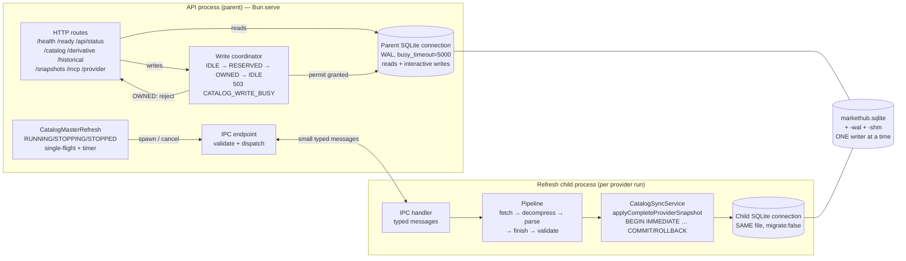

# G0 Child-Process Architecture and Implementation Plan

> **Status:** **PLANNING AND RESEARCH ONLY — no implementation is authorized by this document.** This is a new, standalone plan; it does not replace or rewrite `CATALOG_REFRESH_RELIABILITY_REMEDIATION_PLAN.md`, `CATALOG_REFRESH_STARTUP_DEFECT.md`, `CHATGPT_HANDOFF_CONTEXT.md`, or any other existing plan or record.
>
> **Repository / baseline:** `D:\Temp\MarketHubTS`, branch `develop`, HEAD `cc6a28a519f04e35ee10d274b764cfd1a89cd873`. Installed Bun `1.4.5`; declared `packageManager: bun@1.4.5` (`package.json:5`); `bun-types: 1.4.5`. Runtime-verified SQLite `3.54.1` (`process.versions.sqlite` and `SELECT sqlite_version()`), Windows x64, `process.execPath = C:\Users\RTPC\.bun\bin\bun.exe`.
>
> **Governing documents:** `docs/PROJECT_MANAGER_PROTOCOL.md` (authoritative workflow; §4 twelve-element assignment, §4.1 eighteen-question Option/Metadata Impact Assessment, §4.2 implementation checklist, §4.3 independent-review checklist), `docs/ENGINEERING_STANDARDS.md`, `docs/ARCHITECTURE.md`, `docs/ARCHITECTURE_DECISIONS.md`, `docs/CATALOG_REFRESH_RELIABILITY_REMEDIATION_PLAN.md` (canonical remediation plan; especially §5, §6.1 rows E/F, §7.1–7.5, §10, §13, §15), `docs/CATALOG_REFRESH_STARTUP_DEFECT.md`, `docs/CHATGPT_HANDOFF_CONTEXT.md` §13, `docs/DATABASE.md`, `AGENTS.md`.
>
> **Evidence classes used throughout (never conflated):**
> - **[REPO]** — read directly from the repository at the baseline HEAD (source, tests, manifests, docs).
> - **[PROBE-EXISTING]** — measurements recorded by earlier local probes, *not* independently reproduced by this plan unless stated otherwise.
> - **[PROBE-NEW]** — small probes executed for this plan, all artifacts outside the repo in `D:\Coding\OpenCode\user\tmp\opencode\g0-final-plan\`.
> - **[OFFICIAL]** — current official documentation, fetched 2026-11-26, URLs in §13.
> - **[ASSUMPTION]** — not verified; explicitly flagged and assigned to a G0 acceptance scenario.
>
> **Owner decisions are the planning baseline (§12.1).** No decision is silently changed. Where a decision needs a technical refinement, the genuine reason is stated rather than hidden.

---

## 1. Executive recommendation

**Recommendation:** implement G0 as a **`Bun.spawn` child refresh process + SQLite WAL on the same database file + an application-level write coordinator in the API process**, in five independently reviewable packages in this order: **G0-A** (child foundation) → **G0-B** (move refresh pipeline) → **G0-D** (crash/recovery/shutdown) → **G0-C** (write coordinator) → **G0-E** (real acceptance).

The child owns the *entire* refresh pipeline — download, incremental decompression, incremental parsing, accumulator finalization, fail-closed validation, and the unchanged atomic `applyCompleteProviderSnapshot` transaction — on its own SQLite connection to the **same** file. The API process keeps serving reads from its own WAL connection and never runs the long synchronous apply. A two-phase write permit (`RESERVED` during download/parse, `OWNED` only across the child's transaction) makes interactive writes **fail fast with HTTP 503 `CATALOG_WRITE_BUSY`** instead of sleeping inside SQLite's 5 s `busy_timeout`. No write is ever reported successful merely because it was queued in memory; **G0 queues no writes at all**.

Why this is the best-supported option:
- It fixes **both** root causes with one boundary: the synchronous apply no longer runs on the API thread [REPO + PROBE-EXISTING], and no second writer can enter `BEGIN IMMEDIATE` while the child holds the permit [REPO + OFFICIAL + PROBE-NEW].
- It preserves every protected invariant: one canonical data foundation, one atomic snapshot transaction, fail-closed reconciliation, fixed `UPSTOX`/`FYERS` identity, no new dependency, no migration, no live provider activation [REPO].
- `Bun.spawn` termination, exit observation, IPC and Windows options are **stable documented APIs**; the Bun Worker API is explicitly marked experimental "particularly for terminating workers" [OFFICIAL]. A Worker remains a documented fallback (§11), not a rejected unknown.
- The existing G0 test is **not** proof of real-apply responsiveness: it injects a stubbed `applyCompleteProviderSnapshot` that waits on a deferred gate [REPO: `tests/market/catalog-refresh-wp3-g0.test.ts:140-146`]. G0-E replaces that with a real child, real parsing and a real SQLite transaction.

**This document grants no implementation permission.** See the final section, *Implementation Authorization Required*.

---

## 2. Verified current-state architecture

### 2.1 Process ownership (verified)

| Process | Entry point | Owns | DB connection |
|---|---|---|---|
| API | `apps/api/src/index.ts` (`bun run start` → `scripts/start.ts:14` → `bun src/index.ts`) | `Bun.serve` listener, all repositories/services, `CatalogMasterRefresh` lifecycle, migrations, shutdown | One `DatabaseHandle` from `openDatabase({dbPath})` (`index.ts:112`), WAL, `busy_timeout=5000` |
| MCP STDIO | `apps/mcp-server/src/index.ts` | MCP stdio server; **no direct DB access** — all writes go through the API over HTTP (`MARKETHUB_API_URL`) | None |
| Web | Vite dev server / built static files served by API in production | UI only | None |

There is currently **no refresh child process**. Everything runs in the API process.

### 2.2 Refresh call path (verified)

`startRefreshAfterListening()` (`apps/api/src/index.ts:67-77`, called at `:282` after `Bun.serve` at `:270`) → `CatalogMasterRefresh.startIfNeeded()` (`refresh.ts:184-188`) → one fire-and-forget task per provider (`refresh.ts:195-203,263-273`) → `doRefresh()` (`refresh.ts:275-371`):

1. Freshness check via `catalog.listSyncRuns()` (`refresh.ts:282-295`).
2. `streamUpstoxInto()` (`refresh.ts:392-479`) or `streamFyersInto()` (`refresh.ts:500-605`): real `fetch`, incremental gzip decompression, incremental JSON parsing, incremental SHA-256, in-memory accumulators. No staging files (guard test at `catalog-refresh-wp3-lifecycle.test.ts:310-324`).
3. `accumulator.finish()` → `{batch, reconciliation, report}`; `assertValidCompleteImport()` (`refresh.ts:618-623`) fails closed.
4. `CatalogSyncService.applyCompleteProviderSnapshot(batch, reconciliation)` (`refresh.ts:319,342`; `apply.ts:77-121`) → `repo.transaction(...)` (`catalog.ts:271-288`) → `BEGIN IMMEDIATE` → all upserts + reconciliation + `updateSyncRun` (`apply.ts:193,562-567`) → `COMMIT` / `ROLLBACK`.
5. Failure path records a concise `FAILED` run via `catalog.recordSyncRun()` (`refresh.ts:353-365`) — **a DB write outside the atomic transaction**.

Cancellation boundaries exist only before the transaction (`refresh.ts:278,296,310,318,323,335,341,343,349`); once `BEGIN IMMEDIATE` succeeds, the transaction is never abandoned (WP3-A item 7).

### 2.3 SQLite configuration (verified)

`packages/database/src/index.ts:38-43` on **every** connection opened through `openDatabase`:

```
PRAGMA journal_mode = WAL;
PRAGMA foreign_keys = ON;
PRAGMA synchronous = NORMAL;
PRAGMA busy_timeout = 5000;
```

`close()` (`:60-65`) runs best-effort `PRAGMA wal_checkpoint(TRUNCATE)` then `sqlite.close()`. `resolveDatabasePath()` (`:28-31`) resolves relative paths against `repoRoot`; default `./data/markethub.sqlite`. `runMigrations()` (`:69-74`) is called only by the API at startup (`index.ts:113`).

`SqliteCatalogRepository.transaction()` (`catalog.ts:271-288`) serializes transactions on the instance with `txQueue` and uses `BEGIN IMMEDIATE` / `COMMIT` / `ROLLBACK`. `CandleRepository.upsertCandles()` (`candles.ts:52-101`) and `SqliteSubscriptionRepository.replace()` (`subscriptions.ts:40-68`) use the same pattern.

### 2.4 Write-path surface (summary; exhaustive table in §7)

Writes originate from: provider credential/config routes, retention settings and cleanup, historical sync-config CRUD and on-demand candle writes, snapshot config CRUD and manual capture, MCP activity start/complete/cleanup, subscription replacement, catalog sync runs and the atomic catalog apply. All are currently executed on the API connection with no application-level write ownership.

### 2.5 The existing G0 test does not prove real-apply responsiveness (verified)

`tests/market/catalog-refresh-wp3-g0.test.ts` binds a real `Bun.serve` listener and drives real streaming parsing, but at `:140-146` it injects:

```ts
const sync = {
  applyCompleteProviderSnapshot: async () => {
    applyStarted = true;
    await applyGate.promise; // refresh is inside the DB-apply stage
    return { status: "COMPLETED", counts: {} } as any;
  }
} as unknown as CatalogSyncService;
```

The `applyGate` is a deferred promise; **no SQLite transaction occurs**. The 5 s `fetchWithTimeout` (`:76-84`) is a hang guard, not a latency gate. The test proves listener-first scheduling and responsiveness during a *fake* apply wait and real parsing. It does **not** prove responsiveness during a real import/apply. This plan does not bypass that finding; G0-E replaces the stub.

### 2.6 Evidence inventory

| Claim | Class | Detail |
|---|---|---|
| Real apply blocked `/health` for 2,734 ms | [PROBE-EXISTING] | `wp2-g0-probe.log`: `apply-done ms=2734`, `requestDoneBeforeApply=false`, `applyDoneAtRequest=true` |
| Upstox apply 82.3–95.3 s (median ≈88.8 s, 2 runs); FYERS apply >120 s lower bound | [PROBE-EXISTING] | WP0 baseline recorded in `CATALOG_REFRESH_RELIABILITY_REMEDIATION_PLAN.md` §7.2; not reproduced here |
| Harness event-loop gap 95,282.7 ms during Upstox apply | [PROBE-EXISTING] | Same plan §7.5 note; harness process, **not** API measurement |
| HTTP 200 in 1 ms during a 6 s writer transaction; read saw only pre-txn row; competing write failed after 5,565 ms | [PROBE-EXISTING] | `g0-architecture/probe/concurrency.log` |
| `worker.terminate()` interrupted a tight loop in ~4 ms | [PROBE-EXISTING] | `g0-architecture/probe/termination.log`; official experimental warning still governs |
| Bun 1.4.5 bundles SQLite 3.54.1 | [OFFICIAL] + [PROBE-NEW] | `bun.sh/blog/bun-v1.4.5` dependency table; local `process.versions.sqlite` = `3.54.1` |
| `Bun.spawn` IPC round-trip works on Windows with `process.execPath` + `windowsHide` | [PROBE-NEW] | `probe-ipc-parent.ts` / `probe-ipc-child.ts`: `ready` → `txn-open` → `committed`, exit code 0 |
| Read during child txn sees only committed seed row | [PROBE-NEW] | `readDuringTxn: 1` (seed only), `readAfterCommit: 3` |
| Competing write with `busy_timeout=5000` waited 1,299 ms then succeeded after child commit | [PROBE-NEW] | `probe-ipc-parent.ts`: confirms the API-thread stall mechanism when a write is attempted during a writer txn |
| Killing child mid-transaction rolls back uncommitted row | [PROBE-NEW] | `probe-crash-parent.ts`: exit code 143, `rowsAfterKill: ["seed"]` |
| Parent death leaves child alive (orphan) | [ASSUMPTION] | Not probed; Windows PID-liveness detection is not treated as a correctness mechanism (§6) |

---

## 3. Root-cause analysis of BOTH blocking problems

### 3.1 Problem 1 — synchronous import/apply monopolises the API event loop

`applyCompleteProviderSnapshot()` is `async`, but every DB operation inside it is a synchronous `bun:sqlite`/Drizzle call (`catalog.ts:51-197`, `apply.ts:179-569`). `await`ing those promises yields only microtasks; it does not give the event loop a macrotask turn. The accepted probe [PROBE-EXISTING] shows a `/health` request fired during a 2,734 ms real apply was answered only after completion. On a full official Upstox master the apply is 82–95 s [PROBE-EXISTING], and the harness sampler recorded a ~95 s gap [PROBE-EXISTING]. Listener-first scheduling (`index.ts:270,282`) only ensures the socket is bound before the work starts; it does not help a thread that is later monopolised. The canonical plan states this explicitly at §7.4.9 item 9.

### 3.2 Problem 2 — competing SQLite writers sleep synchronously in `busy_timeout`

`BEGIN IMMEDIATE` acquires the single writer slot at transaction start and holds it for the entire apply. A second connection attempting a write executes SQLite's busy handler, which **sleeps** until `busy_timeout` (5,000 ms) elapses, then returns `SQLITE_BUSY` ("database is locked") [OFFICIAL: `busy_timeout.html`; REPO: `index.ts:43`]. Because that sleep happens inside a synchronous call on the API thread, the API cannot serve requests during it. [PROBE-NEW] reproduced the wait: a competing write blocked 1,299 ms and succeeded only after the child committed; [PROBE-EXISTING] recorded a 5,565 ms failure. WAL readers are unaffected [OFFICIAL: `wal.html` §2.2], but **writers** are serialised [OFFICIAL: `isolation.html`].

### 3.3 Why the two problems must be solved together

Moving only the apply to another connection fixes problem 1 but leaves problem 2: an interactive write on the API connection would still sleep up to 5 s (or fail) while the refresh transaction runs. Adding only a write coordinator fixes problem 2 but leaves the API thread blocked by the synchronous apply. The child-process boundary plus the coordinator addresses both with one ownership model.

---

## 4. Target architecture and data flow

### 4.1 Diagram



ASCII fallback (same topology):

```
                    ┌──────────────────────── API PROCESS (parent) ────────────────────────┐
  LAN / local ─────▶│ Bun.serve → Hono routes                                              │
  clients           │   reads ───────────────────────────────┐                             │
                    │   writes ──▶ [Write coordinator] ──────┤                             │
                    │                IDLE/RESERVED/OWNED     │                             │
                    │                OWNED ⇒ 503 CATALOG_WRITE_BUSY                        │
                    │ [CatalogMasterRefresh] ── spawn/cancel ─┤                             │
                    │                ▲                       ▼                             │
                    │                └── IPC ◀── progress/result ── [Parent DB conn]        │
                    └──────────────────────────────┬───────────────────────────────────────┘
                                                   │ IPC (small, validated, no payloads)
                    ┌──────────────────────────────▼───────────────────────────────────────┐
                    │ REFRESH CHILD PROCESS (one per provider run)                          │
                    │  fetch → gzip → incremental parse → accumulator.finish → validate     │
                    │  → txn-starting (request permit) → await txn-granted                   │
                    │  → BEGIN IMMEDIATE → upserts + reconciliation → COMMIT/ROLLBACK        │
                    │  → txn-settled → result                                               │
                    │  [Child DB conn — same file, migrate:false]                           │
                    └──────────────────────────────┬───────────────────────────────────────┘
                                                   │
                              ┌────────────────────▼────────────────────┐
                              │ markethub.sqlite  (+ -wal, -shm)         │
                              │ WAL: readers see committed snapshots only│
                              │ exactly ONE writer at a time             │
                              └──────────────────────────────────────────┘
```

### 4.2 Process responsibilities

**Parent (API) owns:** HTTP listener; all interactive repositories; migrations at startup; `CatalogMasterRefresh` state machine, single-flight guard and timer; child spawn/cancel/exit handling; the write permit; durable ownership token; persisted run-state verification; all diagnostic `FAILED`/`CANCELLED` run records (so the child writes to SQLite **only** inside the atomic apply transaction); shutdown ordering.

**Child owns:** its own `openDatabase({dbPath, migrate:false})` connection; its own `AbortController`; the full pipeline; the atomic apply; bounded progress/error reporting. It does **not** own scheduling, credentials, configuration, migrations, or any second database.

**Child-mode diagnostic-write bypass (G0-B/D, decision (a) — chosen design):** `CatalogSyncService` has three failure paths that call `recordRunBestEffort()` (`apply.ts:143,612,652` → `:671-677` → `repo.recordSyncRun`, `catalog.ts:477-481`), an **autocommit write outside the atomic transaction**. In child mode this path is **disabled**: the child constructs `CatalogSyncService` with a no-op diagnostic recorder (child-mode flag), so the child performs **no** `recordSyncRun` write outside the atomic apply tx. The child instead returns the structured `CatalogSyncResult` (status, counts, conflicts, error) in the `result` IPC message, and the **parent** records the diagnostic `FAILED` run after settlement (§4.3 step 5, §6.2). This preserves the invariant "child writes SQLite only inside the atomic apply tx" **without weakening it**. Alternatives (b) split pure-apply/diagnostic-record services and (c) remove all child DB side effects outside the tx are not chosen: (a) reuses the existing result shape and keeps a single diagnostic owner (the parent), consistent with §4.2/§6.2/§6.3. The bypass is enforced by a source-scan + runtime test (§7 row 2, §9.2/§9.3).

### 4.3 Data flow (one provider run)

1. Parent timer/first-start triggers `refreshProvider(provider)`. **Freshness-check ownership: parent-side, pre-spawn, read-only.** The parent performs the existing `catalog.listSyncRuns()` check (`refresh.ts:282-295`); if a `COMPLETED` run exists for today it emits `SKIPPED`/`ALREADY_REFRESHED_TODAY` and spawns **no** child. A lookup failure remains diagnostic-only and still proceeds (unchanged semantics). Only when a refresh is actually needed does the parent write the durable ownership token (§6.2) and spawn a child with `{type:"refresh", runId, provider, dbPath, nowIso}`. The child does **not** perform the freshness check and writes **no** run record for a skip; keeping it parent-side avoids spawning a child that would immediately skip and keeps all run-record writes parent-owned (§4.2 decision (a)).
2. Child opens the same DB file with identical PRAGMAs, installs its IPC handler first, sends `ready`, then runs download/decompress/parse/validate. Parent permit is `RESERVED`: interactive writes are allowed; reads are served normally.
3. Child sends `txn-starting`. Parent **synchronously** sets permit `OWNED` (no parent write can be in flight at that instant — single-threaded event loop) and replies `txn-granted`. Child must **wait for the ack** before `BEGIN IMMEDIATE`; this closes the handoff race.
4. Child runs the unchanged `applyCompleteProviderSnapshot` in one transaction. Parent reads continue from its WAL snapshot and see the **old** committed catalogue. Interactive writes receive 503 `CATALOG_WRITE_BUSY` without touching SQLite.
5. Child sends `txn-settled` then `result` (or `error`/`cancelled`), closes its own connection, exits 0. Parent sets permit `IDLE`, clears the ownership token, and records any terminal diagnostic run state.
6. If the child exits unexpectedly, parent marks permit `UNKNOWN`, verifies persisted run state (§6), and only then permits a retry.

### 4.4 Invariants preserved (explicit)

- One canonical data/services foundation; no duplicated market-data logic in child, MCP or WebUI.
- One atomic provider snapshot transaction; reconciliation only after complete fetch/parse/validate; failed/incomplete sources never remove stale records.
- Provider-specific parsing stays in the existing importer modules; fixed `UPSTOX`/`FYERS` identity unchanged.
- No credentials, tokens, secrets, raw payloads or large object graphs cross IPC or enter logs.
- No second DB, no child migrations, no new dependency, no schema/migration change, no live provider activation, no Stage G / M5 Phase 4B / M7 change.
- Live ticks remain in memory; historical/snapshot persistence rules unchanged.

---

## 5. Parent–child lifecycle and IPC design

### 5.1 Spawn contract (G0-A)

- `cmd: [process.execPath, <absolute child entry path>, <dbPath>]`. `process.execPath` is verified locally (`C:\Users\RTPC\.bun\bin\bun.exe`); a bare `"bun"` is not used. [OFFICIAL: child-process docs; PROBE-NEW]
- `cwd: repoRoot` (derive from `packages/database/src/index.ts` `repoRoot` or `import.meta.dir`), `windowsHide: true`, `serialization: "advanced"` (Bun↔Bun default), `env` inherited with no new secrets, `ipc(message, childProc)` handler installed at spawn.
- Child installs `process.on("message", ...)` **before** any top-level `await` or dynamic import that awaits (Worker docs warn about early-message drops; the same discipline is cheap and safe for the child). [OFFICIAL: workers docs]
- Parent retains `Subprocess` handle: `pid`, `exited`, `exitCode`, `signalCode`, `killed`, `send()`, `disconnect()`, `kill()`, `ref()`/`unref()`, `onExit`. Parent does **not** `unref()` a child whose transaction is unsettled; `unref()` is only for a settled/detached child. [OFFICIAL]
- One child per provider run (max two concurrent children, matching current per-provider single-flight). Children may download/parse concurrently; the coordinator serialises their transactions. Provider failure isolation is preserved; only the write slot is shared (unavoidable with SQLite).

### 5.2 Typed and validated IPC messages

Define a single shared module (proposed: `apps/api/src/catalog-refresh-ipc.ts`) with Zod schemas and inferred types, imported with `import type` where possible. All messages are plain objects of primitives/strings; no `AbortSignal`, no `Response`, no parsed rows.

**Parent → child**

| Message | Fields | Purpose |
|---|---|---|
| `refresh` | `type, runId, provider, dbPath, nowIso, intentKey` | Start one provider run |
| `cancel` | `type, runId, reason` | Request cooperative cancellation (child-owned `AbortController`) |
| `txn-granted` | `type, runId` | Ack that parent set permit `OWNED`; child may now `BEGIN IMMEDIATE` |
| `shutdown` | `type, runId` | Graceful termination after settlement |

**Child → parent**

| Message | Fields | Purpose |
|---|---|---|
| `ready` | `type, runId, pid` | Handler installed, DB open |
| `progress` | `type, runId, phase, detail?` | Bounded phase string; no payload |
| `txn-starting` | `type, runId` | Request exclusive write permit |
| `txn-settled` | `type, runId, outcome: COMMITTED\|ROLLED_BACK\|FAILED` | Transaction reached its boundary |
| `result` | `type, runId, status, counts, sourceVersion?, conflicts?, error?` | Terminal success/failure summary; on failure carries structured `conflicts`/`error` so the parent can record the diagnostic FAILED run (§4.2 decision (a)) |
| `cancelled` | `type, runId, reason` | Distinct from FAILED; no reconciliation |
| `error` | `type, runId, code, message` | Sanitised, bounded (≤300 chars, matching existing convention) |

Validation: every inbound message is `safeParse`d; invalid messages are logged concisely and treated as protocol errors (child killed / run FAILED). Unknown `runId` is ignored. No message may contain credentials, tokens, file contents, row arrays or full source hashes of raw payloads (sourceVersion hash is a short hex string and is allowed).

### 5.3 State machines

**Parent refresh lifecycle** (reuse existing `CatalogRefreshState` from `refresh.ts:66`): `RUNNING → STOPPING → STOPPED`, unchanged semantics; `stopAndWait()` additionally awaits child settlement and permit release.

**Write permit** (new, parent-only): `IDLE → RESERVED → OWNED → RELEASING → IDLE`, plus `UNKNOWN` on unexpected child exit. Only `OWNED`/`RELEASING`/`UNKNOWN` reject interactive writes. `RESERVED` allows them (no DB writer exists yet).

**Child phase**: `INIT → DOWNLOAD → PARSE → VALIDATE → AWAIT_TXN_GRANT → TXN → SETTLED → EXIT`, with `CANCELLED`/`FAILED` terminal branches. Cancellation is checked only at the existing boundaries; once `TXN` starts it runs to `COMMIT`/`ROLLBACK`.

### 5.4 Cancellation and termination

- `cancel` is a message; the child creates and owns its `AbortController`. An `AbortSignal` cannot cross IPC as a live object [OFFICIAL: structured clone / advanced serialization copy values].
- Graceful path: parent sends `cancel`, child aborts fetch/parse at boundaries, skips apply, sends `cancelled`, closes DB, exits 0.
- Escalation: `proc.kill()` / `signal` / `timeout` are last-resort only after the transaction is known settled, or when a watchdog proves the child unresponsive. Bun's documented `signal`, `timeout`, `killSignal` options are available [OFFICIAL] but are **not** the correctness mechanism.
- A referenced child keeps the parent alive until it exits [OFFICIAL]; shutdown must explicitly await `proc.exited` before closing the parent DB.

### 5.5 Explicit non-goals of the IPC layer

No large data transfer, no second DB, no child-side migrations, no child-side config writes, no child-side credential access, no new npm dependency, no new WebUI option or MCP operation.

---

## 6. Crash recovery and writer ownership design (G0-D — critical)

### 6.1 Why lease expiry alone is insufficient

A timestamp lease cannot distinguish: child alive but slow (download/parse can legitimately take 90–120 s [PROBE-EXISTING]); child dead mid-transaction; child committed but IPC ack lost; parent dead with child alive; or a new parent starting while an orphan child still holds the SQLite write lock. Expiring a lease and starting a second child could create **two writers** and, worse, a second reconciliation from a source whose first apply already committed. Therefore ownership is established by **four independent signals**, not by time alone.

### 6.2 Layered ownership model

1. **In-process permit** (parent memory): fast fail for interactive writes; authoritative only while the parent is alive.
2. **Durable ownership token** in `app_meta` (no schema change): key `catalog_refresh_owner`, JSON `{runId, provider, pid, startedAt, heartbeatAt, phase}`. Written by the parent **before** dispatch; updated by the child on phase transitions; deleted by the parent after settlement. Survives parent restart and is readable by a new parent.
3. **IPC / exit liveness**: parent observes `ipc` messages, `onExit`, `proc.exited`, `exitCode`, `signalCode`. Unexpected exit without `txn-settled`/`result` ⇒ permit becomes `UNKNOWN`; no new child is granted until verification completes.
4. **Persisted run-state verification**: `catalog_sync_runs` already records `RUNNING` at transaction start (`apply.ts:193`) and terminal status at `apply.ts:562-567`, both inside the atomic transaction. Therefore:
   - terminal row for `runId` (`COMPLETED`/`FAILED`) ⇒ transaction reached its boundary; **do not re-apply**;
   - no terminal row (or only the pre-transaction intent) ⇒ transaction did not commit; safe to retry after confirming no live writer.
5. **Bounded live-writer probe** (supporting, not correctness): on recovery, the parent attempts `BEGIN IMMEDIATE` + immediate `ROLLBACK` on its own connection with a short, explicitly documented probe timeout (proposed 250 ms; a probe parameter, **not** a change to the production `busy_timeout=5000`). Failure ⇒ a writer may still be active ⇒ refuse to start a new child and return a retryable error. [ASSUMPTION: Windows behaviour to be confirmed in G0-D/E]

The durable token is written while permit is `RESERVED` (before `OWNED`), so it cannot contend with the child's transaction. All diagnostic `FAILED`/`CANCELLED` run records are written by the **parent** after child settlement, so the child never writes outside the atomic transaction. Concretely, the child-mode `CatalogSyncService` disables `recordRunBestEffort()` (`apply.ts:143,612,652,671-677`) so no autocommit `recordSyncRun` (`catalog.ts:477-481`) occurs in the child; failure details travel back in the structured `result` IPC message and the parent records the diagnostic row (decision (a), §4.2). The persisted `RUNNING`/terminal rows at `apply.ts:193,562-567` remain **inside** the atomic tx and are the authoritative recovery signal (item 4 above).

### 6.3 Scenario handling table

| Scenario | Detection | Required outcome |
|---|---|---|
| IPC disconnection while child alive | `ipc` channel closes / no heartbeat; `proc.exited` not yet resolved | Permit → `UNKNOWN`; do not grant a new child; verify run state and probe lock; kill only after txn known settled or watchdog |
| Parent crash while child alive | New parent reads durable token on startup | New parent does **not** immediately spawn; verifies token phase, run state and lock probe; if a writer is active, refuses with retryable error; if settled, clears token and resumes scheduling |
| Child crash during download/parse | `onExit` non-zero / signal, no `txn-starting` | No DB write; parent records concise `FAILED`; permit → `IDLE`; last-known-good catalogue intact |
| Child crash during transaction | `onExit` without `txn-settled`; token phase `TXN` | SQLite rolls back uncommitted rows [OFFICIAL: `wal.html`, `isolation.html`; PROBE-NEW confirmed]; parent verifies no terminal run row, records `FAILED`, clears token; no reconciliation |
| Child crash after commit before IPC ack | Token phase `TXN`, terminal `COMPLETED` run row exists | Parent **does not retry**; treats run as committed based on persisted state; reports success/observes new snapshot; clears token |
| API restart with prior child alive | Durable token + lock probe | No second writer; new parent waits/refuses until verified; never two children with write ownership |
| Duplicate refresh prevention | Existing per-provider `inFlight` map + durable token | A second `refreshProvider` for the same provider is a no-op; a stale token from a previous process is not treated as in-flight without verification |
| Graceful shutdown | `SIGINT`/`SIGTERM`/stdin-end | Ordered drain (§6.4); `stopAndWait()` resolves only after child exit and permit release |

### 6.4 Shutdown order (observable and tested)

1. Stop scheduling: `beginStop()` clears the timer and rejects new starts (`refresh.ts:225-241`).
2. Abort network: send `cancel` to every child; child-owned `AbortController` aborts fetch/parse at existing boundaries.
3. Allow transaction to finish or roll back: child never abandons `BEGIN IMMEDIATE`; parent awaits `txn-settled` / `result` / `exited`.
4. Wait child exit: `await proc.exited`; verify exit code/signal; release permit; clear durable token.
5. Close child DB: performed by the child before exit (its own `DatabaseHandle.close()`).
6. Close parent DB: only after steps 1–5; existing `db?.close()` (`index.ts:329`) moves after child settlement.

Startup-failure drain (`drainStartupFailure()`, `index.ts:84-92`) uses the same sequence. Repeated `stop()`/`stopAndWait()` remain idempotent.

---

## 7. Exhaustive write-path inventory

Source: direct search of `apps/api/src/**`, `packages/database/src/**`, `packages/market-core/src/**`, `packages/broker-*/src/**` at baseline HEAD. "Priority" = `I` interactive (user/API initiated, must fail fast) or `B` background (scheduler/cleanup; G0 does not queue — skip and retry on next cycle). "Caller process" is `API` today and after G0 remains `API` for all rows except the catalog apply, which moves to `CHILD`.

| # | Operation | Entry point | Repository / method | Transaction | Caller process | Priority | Required behaviour during `OWNED` | Bypass-detection test |
|---|---|---|---|---|---|---|---|---|
| 1 | Complete provider snapshot apply | `CatalogMasterRefresh.doRefresh` → `CatalogSyncService.applyCompleteProviderSnapshot` (`refresh.ts:319,342`; `apply.ts:77-121`) | `SqliteCatalogRepository.transaction` → `TxRepo.*` (`catalog.ts:271-288`) | **One `BEGIN IMMEDIATE`** incl. reconciliation + `updateSyncRun` | **CHILD** (was API) | B | Runs only in child after `txn-granted`; parent never calls it during refresh | Assert no parent-side call; assert child is sole holder of permit; assert one `BEGIN IMMEDIATE` per run |
| 1b | Partial snapshot apply (`applyBatch`) | `CatalogSyncService.applyBatch` (`apply.ts:59-70`) → `prepareRun` → `repo.transaction` → `applyBatchInTx` → `handleFailure` | `SqliteCatalogRepository.transaction` → `TxRepo.*` (`catalog.ts:271-288`) | One `BEGIN IMMEDIATE` (no reconciliation) | API today, **test-only** [REPO: no runtime caller in `refresh.ts` or `apps/api/src/**`] | B | Not invoked by any G0 runtime path; if it ever is, it inherits #1/#2 gating: child-only atomic apply, `recordRunBestEffort` disabled in child mode, parent records diagnostics | Source-scan guard: assert no `.applyBatch(` call in `apps/api/src/**` or `packages/market-core/src/sync/refresh.ts` (only `applyCompleteProviderSnapshot` is called); runtime matrix need not exercise it; adding a runtime caller requires a new assignment |
| 2 | FAILED refresh run record (both paths) | `refresh.ts:353-365` (pipeline failure) **and** `apply.ts:143,612,652` → `recordRunBestEffort` (`:671-677`) (apply failure) | `SqliteCatalogRepository.recordSyncRun` (`catalog.ts:477-481`) | Autocommit | **API** (moved from child; child-mode bypass disables `recordRunBestEffort`) | B | Written only by the parent after child settlement; never during `OWNED`; child never calls `recordSyncRun` outside the atomic tx | **Bypass test:** source-scan asserts the child entry/pipeline contains no `recordSyncRun`/`recordRunBestEffort` write and that `CatalogSyncService` is constructed in child mode with the diagnostic recorder disabled; runtime test drives all three apply failure paths in the child and asserts zero autocommit `recordSyncRun` on the child connection, structured `result` carries the failure, and the FAILED row appears only after parent settlement |
| 3 | Sync run create/update inside apply | `apply.ts:193,562-567` | `TxRepo.createSyncRun`, `TxRepo.updateSyncRun` | Inside apply txn | CHILD | B | Atomic with snapshot; the **only** child-side sync-run write, and it is inside the tx | Assert terminal row exists iff commit happened (commit-before-ack scenario); assert no other `catalogSyncRuns` write on the child connection |
| 4 | Instrument upsert | `apply.ts:408` | `TxRepo.upsertInstrument` (`catalog.ts:51-68`) | Inside apply txn | CHILD | B | Child only | Source-scan: no direct call outside `applyBatchInTx` |
| 5 | Derivative contract upsert | `apply.ts:408` via `upsertInstrument` | `TxRepo.upsertDerivativeContract` (`catalog.ts:69-77`) | Inside apply txn | CHILD | B | Child only | Same as #4 |
| 6 | Provider mapping upsert | `apply.ts:518` | `TxRepo.upsertMapping` (`catalog.ts:86-99`) | Inside apply txn | CHILD | B | Child only | Same as #4 |
| 7 | Alias upsert | `apply.ts:530` | `TxRepo.upsertAlias` (`catalog.ts:100-121`) | Inside apply txn | CHILD | B | Child only | Same as #4 |
| 8 | Identifier upsert / supersede | `apply.ts:434,439,462,541` | `TxRepo.upsertIdentifier` (`catalog.ts:122-173`) | Inside apply txn | CHILD | B | Child only | Same as #4 |
| 9 | Provider mapping reconciliation | `apply.ts:95-103` | `TxRepo.reconcileProviderMappings` (`catalog.ts:205-263`) | Inside apply txn | CHILD | B | Only after complete validated source | Assert zero REMOVED rows on failed/cancelled source |
| 10 | Upstox token set | `POST /api/provider/upstox/token` (`provider-routes.ts:76-88`) → `UpstoxAdapter.setToken` → `SqliteCredentialStore.set` (`credentials.ts:166-206`) | `providerCredentials` upsert | Autocommit | API | I | 503 `CATALOG_WRITE_BUSY`, no encryption/key-file work, no DB mutation | Route test during `OWNED` + direct repository test |
| 11 | FYERS config set | `POST /api/provider/fyers/config` (`provider-routes.ts:91-103`) → `SqliteProviderSettings.set` (`provider-settings.ts:15-22`) | `providerSettings` upsert | Autocommit | API | I | 503, no mutation | Route + repository test |
| 12 | FYERS app secret set | `POST /api/provider/fyers/app-secret` (`provider-routes.ts:104-115`) → `SqliteCredentialStore.set` | `providerCredentials` upsert | Autocommit | API | I | 503 | Route + repository test |
| 13 | FYERS auth completion token writes | `GET /api/provider/fyers/callback` (`provider-routes.ts:126-137`) → adapter → `credentials.set` / `settings.set` / `credentials.delete` | Multiple autocommit | Autocommit | API | I | 503 before any write; callback must not partially persist | Route test with mocked adapter during `OWNED` |
| 14 | Provider validate (read/status-only) and adapter credential writes | `POST /api/provider/:id/validate` (`provider-routes.ts:141-148`) → `ProviderRegistry.validate` (`provider.ts:73-88`) → `adapter.validate()` | **No DB write in `validate()`** (verified read/status-only); writes occur in `setToken`/`setConfig`/`setAppSecret`/`completeAuth`/`remove` — see the exhaustive adapter write-path sweep below | Autocommit (in those other methods) | API | I | 503 before adapter runs; `validate` is read-only but still gated so no status side-effect is reported as success | Route test during `OWNED` per method |
| 15 | Provider remove | `POST /api/provider/:id/remove` (`provider-routes.ts:150-161`) → `ProviderRegistry.remove` → credential/settings deletes | Multiple autocommit | Autocommit | API | I | 503, no partial removal | Route test during `OWNED` |
| 16 | Credential store reset | `POST /api/credentials/reset` (`provider-routes.ts:165-172`) → `SqliteCredentialStore.reset` (`credentials.ts:215-225`) | `providerCredentials` delete + key-file replace | Autocommit | API | I | 503 **before** key-file deletion; never leave DB/key mismatch | Route test + filesystem assertion during `OWNED` |
| 17 | Retention settings update | `PUT /api/retention` (`historical-routes.ts:141-149`) → `AppSettings.setRetention` (`app-settings.ts:29-36`) | `app_meta` upsert | Autocommit | API | I | 503 | Route + repository test |
| 18 | Retention cleanup (candles/snapshots/activities) | `POST /api/retention/cleanup` (`historical-routes.ts:151-156`) → `applyRetentionCleanup` (`:37-59`) → `cleanupCandles` (`candles.ts:231-243`), `cleanupSnapshots` (`snapshots.ts:166-179`), `cleanupActivities` (`mcp-activity.ts:195-208`) | Batched `DELETE` loops | Autocommit batches | API | I (user-triggered) | 503; no partial deletion | Route test during `OWNED`; assert row counts unchanged |
| 19 | Historical sync config create/update | `POST /api/historical/sync-configs` (`historical-routes.ts:117-125`) → `CandleRepository.putSyncConfig` (`candles.ts:252-281`) | `historicalSyncConfigs` upsert | Autocommit | API | I | 503 | Route + repository test |
| 20 | Historical sync config delete | `DELETE /api/historical/sync-configs/:id` (`historical-routes.ts:127-133`) → `deleteSyncConfig` (`candles.ts:294-296`) | Delete | Autocommit | API | I | 503 | Route + repository test |
| 21 | On-demand candle write / conflict note | `POST /api/historical/fetch` (`historical-routes.ts:96-110`) → `HistoricalCandleService.fetchOnDemand` (`historical/service.ts:101-160`) → `upsertCandles` (`candles.ts:49-102`), `addRangeNote` (`:181-201`) | `BEGIN IMMEDIATE` for candles | API | I | 503 before provider fetch; no note written | Route test during `OWNED`; assert no `BEGIN IMMEDIATE` |
| 22 | Scheduled historical sync writes | `HistoricalCandleService.runSync` (`historical/service.ts:163+`) → `upsertCandles` / `addRangeNote` | `BEGIN IMMEDIATE` | API | B | Skip cycle, retry on next schedule; **no in-memory queue**. Observable contract (§8.1): no DB mutation, no success/completion status, explicit retryable/skipped diagnostic | Scheduler test during `OWNED`: assert zero row-count change, no `BEGIN IMMEDIATE`, no success/completion event, and a `SKIPPED`/retryable diagnostic emitted |
| 23 | Snapshot capture config create/update | `POST /api/snapshots/configs` (`snapshot-routes.ts:40-48`) → `OptionChainSnapshotService.putCaptureConfig` (`snapshots/service.ts:61-63`) → `SnapshotRepository.putCaptureConfig` (`snapshots.ts:14-41`) | Upsert | Autocommit | API | I | 503 | Route + repository test |
| 24 | Snapshot capture config delete | `DELETE /api/snapshots/configs/:id` (`snapshot-routes.ts:50-56`) → `deleteCaptureConfig` (`snapshots.ts:80-82`) | Delete | Autocommit | API | I | 503 | Route + repository test |
| 25 | Manual snapshot capture | `POST /api/snapshots/capture` (`snapshot-routes.ts:61-82`) → `captureOnDemand` (`snapshots/service.ts:123-125,138-169`) → `putSnapshot` (`snapshots.ts:85-94`) | `INSERT OR IGNORE` | API | I | 503 before provider call; no snapshot written | Route test during `OWNED` |
| 26 | Scheduled snapshot capture | `OptionChainSnapshotService.captureScheduled` (`snapshots/service.ts:128-136`) → `putSnapshot` | `INSERT OR IGNORE` | API | B | Skip cycle, retry next schedule. Observable contract (§8.1): no DB mutation, no success/completion status, explicit retryable/skipped diagnostic | Scheduler test during `OWNED`: assert zero row-count change, no `putSnapshot` call, no success/completion event, and a `SKIPPED`/retryable diagnostic emitted |
| 27 | MCP activity start (HTTP in-process) | `createHttpMcpServices.startActivity` (`mcp-services.ts:103-108`) → `McpActivityRepository.start` (`mcp-activity.ts:64-89`) | `INSERT OR IGNORE` | API | I | 503; MCP tool reports retryable error, not success | MCP tool test during `OWNED` |
| 28 | MCP activity complete (HTTP in-process) | `mcp-services.ts:109-119` → `McpActivityRepository.complete` (`mcp-activity.ts:92-145`) | Conditional `UPDATE` | API | I | 503 | MCP tool test during `OWNED` |
| 29 | MCP activity start/complete (STDIO via REST) | `POST /api/mcp/activity/start|complete` (`mcp-activity-routes.ts:84-137`) → same repository | Same as #27/#28 | API | I | 503 | Route test during `OWNED` |
| 30 | Subscription replacement | `PUT /api/market/subscriptions` (`market-routes.ts:112-135`) → `SubscriptionCoordinator.replaceSubscriptions` (`subscription-coordinator.ts:59`) / `StreamSupervisor` (`stream-supervisor.ts:311`) → `SqliteSubscriptionRepository.replace` (`subscriptions.ts:30-74`) | `BEGIN IMMEDIATE` + generation bump | API | I | 503 before any delete/insert/generation change | Route test during `OWNED`; assert generation unchanged |
| 31 | Durable ownership token write/clear | New coordinator module | `app_meta` upsert/delete | Autocommit | API | B (internal) | Written only in `RESERVED`/`IDLE`; never in `OWNED` | Assert token transitions ordered; assert no token write during `OWNED` |
| 32 | Migrations | `index.ts:113` → `runMigrations` (`database/index.ts:69-74`) | DDL | API at startup only | API | B | Must complete before any child spawn; child never calls it | Assert child entry contains no `runMigrations`; assert startup order |

**Exhaustive adapter write-path sweep ([REPO], re-run for this audit):** every credential/settings write reachable from a provider route, with line-accurate citations. `validate()` performs **no** `credentials.delete`/`settings.delete` and no credential write in either adapter or in `ProviderRegistry.validate` (`provider.ts:73-88`, which only delegates to `adapter.validate()`); it is read/status-only. The earlier row-14 citation (`broker-upstox/src/index.ts:167,228-229`; `broker-fyers/src/index.ts:234,359-362`) was inaccurate because it attributed deletes to `validate()`; the correct method split is below.

| Adapter method | Route | Write operations (verified) | Inventory row |
|---|---|---|---|
| `UpstoxAdapter.setToken` (`broker-upstox/src/index.ts:160-180`) | `POST /api/provider/upstox/token` | `credentials.set` (`:160`); `settings.set` expiry (`:163`) **or** `settings.delete` expiry (`:167`) | #10 |
| `UpstoxAdapter.validate` (`broker-upstox/src/index.ts:182-225`) | `POST /api/provider/:id/validate` | **None** — reads token + status only | #14 (read-only) |
| `UpstoxAdapter.remove` (`broker-upstox/src/index.ts:227-234`) | `POST /api/provider/:id/remove` | `credentials.delete` (`:228`), `settings.delete` expiry (`:229`) | #15 |
| `FyersAdapter.setConfig` (`broker-fyers/src/index.ts:153-161`) | `POST /api/provider/fyers/config` | `settings.set` app ID (`:160`), redirect URI (`:161`) | #11 |
| `FyersAdapter.setAppSecret` (`broker-fyers/src/index.ts:256-263`) | `POST /api/provider/fyers/app-secret` | `credentials.set` candidate secret (`:261`) | #12 |
| `FyersAdapter.completeAuth` (`broker-fyers/src/index.ts:231-254`) | `GET /api/provider/fyers/callback` | `credentials.set` app secret (`:233`), `credentials.delete` candidate secret (`:234`), `credentials.set` access token (`:236`), `settings.set` expiry (`:238`) | #13 |
| `FyersAdapter.validate` (`broker-fyers/src/index.ts:265-345`) | `POST /api/provider/:id/validate` | **None** — reads token/expiry + status only | #14 (read-only) |
| `FyersAdapter.remove` (`broker-fyers/src/index.ts:347-369`) | `POST /api/provider/:id/remove` | `credentials.delete` access token (`:359`), app secret (`:360`), candidate secret (`:361`), `settings.delete` expiry (`:362`) | #15 |

No other inaccurate citations were found in the adapter/route write paths; the repository-level citations in rows #10–#16 (`credentials.ts:166-206,215-225`, `provider-settings.ts:15-22`) remain accurate.

**Bypass detection strategy (three layers):**
1. **Gate at the repository boundary** — every write method above calls `assertWritable(priority)` at method entry, not only at routes. Direct repository calls from tests or future code are covered.
2. **Source-scan test** — analogous to the existing staging guard (`catalog-refresh-wp3-lifecycle.test.ts:310-324`), scan write-capable modules for `.insert(`, `.update(`, `.delete(`, `.run()`, `BEGIN IMMEDIATE` and assert each is inside a gate-guarded method or the child-only apply path. New unguarded writes fail the test. The same scan asserts `applyBatch` (`apply.ts:59-70`, row #1b) has **no** caller in `apps/api/src/**` or `refresh.ts` during G0, and that no child-side `recordSyncRun`/`recordRunBestEffort` write exists outside the atomic tx (row #2).
3. **Runtime matrix** — while permit is `OWNED`, invoke every interactive entry point (#10–#30) and assert 503 + zero row-count change; invoke background entry points (#21/#22/#25/#26) and assert no write and no success response.

---

## 8. Write-coordinator contract and error semantics

### 8.1 Contract

- Module: proposed `apps/api/src/catalog-write-coordinator.ts` (API-process concern), with a small gate interface consumed by `packages/database` write methods. Default state `IDLE`; no refresh ⇒ all writes allowed (preserves existing tests that construct repositories directly).
- `acquireReserved(runId, provider)` → writes durable token; `requestTxn(runId)` → synchronously sets `OWNED`, returns ack; `release(runId, outcome)` → `IDLE`, clears token; `markUnknown(runId)` → `UNKNOWN` pending verification.
- `assertWritable(priority)`:
  - `I` (interactive): throws `CatalogWriteBusyError` when state is `OWNED`, `RELEASING` or `UNKNOWN`.
  - `B` (background): does **not** queue; returns a "skip" signal to the caller, which must not report success. Scheduler-driven work retries on its next tick.
  - `INTERNAL` (ownership token / diagnostic run records): allowed only in `RESERVED`/`IDLE`, never in `OWNED`.

**Background skip — concrete observable contract (applies to every `B` skip row, notably #22 and #26):** when `assertWritable("B")` returns the skip signal during `OWNED`/`RELEASING`/`UNKNOWN`, the caller MUST satisfy all four conditions: (1) **no DB mutation** — zero row-count change and no `BEGIN IMMEDIATE`/`INSERT`/`UPDATE`/`DELETE` on any table; (2) **no success status** — the scheduler emits no `COMPLETED`/`REFRESHED`/success event and no "run finished" log; (3) **explicit diagnostic** — a `SKIPPED` outcome with `reason: "CATALOG_WRITE_BUSY"` and `retryable: true` is emitted (in-memory event/log only, never a persisted success row); (4) **retry on next tick** — the scheduler's next scheduled invocation runs normally once the permit returns to `IDLE`. No volatile in-memory queue is created. Tests: for #22 and #26, drive the scheduler while permit is `OWNED` and assert (a) row counts unchanged, (b) no write method invoked (spy on `upsertCandles`/`addRangeNote`/`putSnapshot`), (c) no success/completion event emitted, (d) a `SKIPPED`/retryable diagnostic present, and (e) a subsequent tick after `IDLE` performs the write and emits success. This proves schedulers do not emit success/completion on skip.

### 8.2 Error semantics

- HTTP mapping: `503` with the existing `apiErrorSchema` (`packages/contracts/src/index.ts:59-63` — `{error, message?, details?}`), e.g.
  `{ error: "CATALOG_WRITE_BUSY", message: "Catalog refresh owns the database write lock; retry shortly", details: { retryable: true, code: "CATALOG_WRITE_BUSY", provider: "UPSTOX" } }`.
  No contract/schema change is required; the code is a backend-owned module constant, not a duplicated frontend literal.
- MCP tools return `{ok:false, error:{category:"unavailable", message:"CATALOG_WRITE_BUSY"}}` through the existing `McpServices` error shape; no activity row is written.
- `SQLITE_BUSY` that still reaches SQLite (e.g., orphan child) is mapped to the same 503 retryable error and logged as a contention event. **`busy_timeout` stays at 5000 ms as a safety fallback only**; it is never raised to hide contention and never used as the primary coordination mechanism.
- No write is ever acknowledged as successful while only placed in a volatile in-memory queue. **G0 implements no queue.** Durable background queueing, if ever needed, requires its own design with persisted intent and replay (out of scope).

### 8.3 How bypass is made difficult

- Gate lives in the repository methods, so route-level omissions cannot bypass it.
- Child process is the only caller of `applyCompleteProviderSnapshot`; parent-side calls are gated and tested.
- Source-scan and runtime matrix tests (§7) make an unguarded new write path fail CI locally.
- No second DB path is available to the child: `dbPath` is passed from the parent and verified to resolve to the same file as the parent's `db.path` before any child work (G0-A acceptance).

---

## 9. Implementation packages G0-A → G0-E

Each package below uses the twelve required assignment elements of `PROJECT_MANAGER_PROTOCOL.md` §4. The Option/Metadata Impact Assessment (§4.1) is answered once for the whole programme in §12.3 and is incorporated by reference in each package's element 12. **No package grants commit/push permission.**

### 9.1 G0-A — Child foundation

1. **Objective:** establish a Windows-verified parent/child process boundary with typed, validated IPC and independent DB connections to the same file, before moving any refresh logic.
2. **Verified current state:** no child process exists; `Bun.spawn` is used only by `scripts/start.ts:14` with a bare `"bun"`; `openDatabase` sets WAL + `busy_timeout=5000` (`database/index.ts:38-43`); `process.execPath` and SQLite 3.54.1 verified locally [REPO + PROBE-NEW].
3. **Exact scope:** new child entry module; new IPC contract module; parent-side child manager (spawn/ready/cancel/exit/IPC validation); DB-path identity verification; minimal `ping`/`ready` round-trip only. No refresh pipeline yet.
4. **Architectural direction:** parent owns lifecycle; child opens `openDatabase({dbPath, migrate:false})`; same file verified by both; small validated messages only; no large data, no second DB, no child migrations.
5. **Files allowed to change (on approval):** new `apps/api/src/catalog-refresh-child.ts`, new `apps/api/src/catalog-refresh-ipc.ts`, new `apps/api/src/catalog-refresh-child-manager.ts`; `apps/api/src/index.ts` (construction + drain hooks only); new `tests/api/catalog-refresh-child.test.ts`. No schema/migration/manifest/lockfile changes.
6. **Protected areas:** all pre-existing modified/untracked docs; `main`; migrations/schema; lockfile; product scope; fixed provider identity; live-provider boundary; existing tests except the new file.
7. **Non-goals:** no download/parse/apply; no write coordinator; no crash-recovery policy beyond exit observation; no config/UI/MCP changes.
8. **Acceptance criteria:** child spawned with `process.execPath` + `windowsHide`; `ready` received and schema-valid; parent and child report the same resolved DB path; child connection reports `journal_mode=wal` and SQLite 3.54.1; child exits 0 on `shutdown`; unexpected kill surfaces `onExit`/`exited` with code/signal; no `-journal` second DB created; no migration executed by child.
9. **Required tests:** real Windows spawn/IPC round-trip; DB-path identity assertion; exit-code and unexpected-kill observation; message validation rejects malformed/unknown messages; no large payload transferred (message size assertion).
10. **Verification instructions:** `bun test tests/api/catalog-refresh-child.test.ts`, `bun run typecheck`, `git status --short` before/after; record Bun/SQLite versions and exact command output.
11. **Expected report format:** objective, files changed, evidence (commands + outputs), complete/incomplete/unverified, `git status` before/after, independent-review checklist result.
12. **Option/Metadata Impact Assessment:** §12.3 (all 18 answers: no new options/entities/config).

**Risks / rollback:** Windows path/quoting (mitigated by `process.execPath`, absolute entry, `windowsHide`); child keeping parent alive (mitigated by explicit `await proc.exited`); revert the three new modules and the `index.ts` hook. **Dependencies:** none beyond G0 baseline.

### 9.2 G0-B — Move refresh pipeline into the child

1. **Objective:** run the complete refresh pipeline in the child while preserving provider independence and the atomic snapshot transaction.
2. **Verified current state:** `doRefresh()` (`refresh.ts:275-371`) performs fetch/parse/validate/apply and failure-record writes in the API process; importers and `apply.ts` are reusable unchanged; cancellation boundaries are explicit.
3. **Exact scope:** child handles `refresh`/`cancel`/`txn-granted`; parent retains scheduling, single-flight, timer and lifecycle; parent records diagnostic FAILED/CANCELLED runs after settlement; child writes only inside the atomic apply. Child-mode `CatalogSyncService` disables `recordRunBestEffort` (`apply.ts:143,612,652,671-677`) so no autocommit `recordSyncRun` occurs in the child; failure details return in the structured `result` IPC message for parent-owned recording (decision (a), §4.2). The read-only freshness check (`refresh.ts:282-295`) stays parent-side pre-spawn (§4.3 step 1); the child never runs it and writes no run record for a skip.
4. **Architectural direction:** reuse `streamUpstoxInto`/`streamFyersInto`, accumulators, `assertValidCompleteImport`, `CatalogSyncService.applyCompleteProviderSnapshot` **unchanged**; move only orchestration (which process calls them, IPC progress, child-owned `AbortController`).
5. **Files allowed to change (on approval):** `packages/market-core/src/sync/refresh.ts` (orchestration split only — keep parsing/validation/apply semantics), `packages/market-core/src/sync/apply.ts` (**additive only**: optional child-mode diagnostic-recorder injection so `recordRunBestEffort` is a no-op in the child — no change to transaction/reconciliation/conflict logic, §4.2 decision (a)), new child pipeline adapter module, `apps/api/src/index.ts` (wire child manager into `CatalogMasterRefresh`), `tests/market/catalog-refresh-wp3-g0.test.ts` (replace stub with real child path in a separate new test file, preserving the original as a regression), new `tests/market/catalog-refresh-child-pipeline.test.ts`.
6. **Protected areas:** importer modules (`upstox-master.ts`, `fyers-master.ts`, `normalize.ts`, `import-report.ts`) and `apply.ts` **apply semantics** (atomic transaction, reconciliation gate, conflict handling — unchanged; only the diagnostic-recorder injection point is added); atomic transaction; fail-closed validation; fixed provider identity; all pre-existing user work.
7. **Non-goals:** no write coordinator enforcement (G0-C); no crash-recovery policy beyond G0-A exit observation (G0-D); no caching/conditional requests; no live provider activation.
8. **Acceptance criteria:** real child performs download→parse→validate→apply for both providers independently; one `BEGIN IMMEDIATE` per successful run; reconciliation gated exactly as before; malformed source ⇒ zero apply calls; Upstox failure does not block FYERS; no large data crosses IPC; parent reads remain responsive during child parse (real parsing, still stub-free for the apply stage until G0-E).
9. **Required tests:** fixture-driven Upstox and FYERS child runs; golden counts/hashes vs existing fixtures; malformed/truncated/oversized source fail-closed; provider isolation; IPC payload-size bound; source-scan asserting no staging-file writes; bypass test asserting no child autocommit `recordSyncRun` outside the atomic tx (§7 row 2).
10. **Verification instructions:** focused catalog tests + full suite; typecheck/build; record stage timings as evidence (no thresholds).
11. **Expected report format:** as §9.1, plus explicit statement of which modules are reused unchanged vs which orchestration moved.
12. **Option/Metadata Impact Assessment:** §12.3.

**Risks / rollback:** orchestration split could alter cancellation timing — covered by existing lifecycle tests; revert orchestration module and restore `refresh.ts` from the approved baseline. **Dependencies:** G0-A.

### 9.3 G0-D — Crash recovery, writer ownership and shutdown

1. **Objective:** guarantee a new child cannot acquire write ownership while an old child may still be writing, and define verified recovery for every crash/commit/ack scenario.
2. **Verified current state:** lease-only reasoning is insufficient; SQLite rolls back uncommitted transactions on connection death [OFFICIAL + PROBE-NEW]; `catalog_sync_runs` terminal status is written inside the atomic transaction (`apply.ts:562-567`); current shutdown drains in-process tasks only (`index.ts:295-337`).
3. **Exact scope:** durable ownership token in `app_meta`; permit states `RESERVED/OWNED/RELEASING/UNKNOWN`; `txn-starting`/`txn-granted` ack handshake; persisted run-state verification; bounded live-writer probe; ordered shutdown; startup recovery path; parent-owned diagnostic recording after settlement with the child-mode `recordRunBestEffort` bypass (§4.2, §6.2).
4. **Architectural direction:** four independent signals (§6.2); no lease-only decision; no PID-liveness as correctness mechanism; parent is the sole recorder of terminal diagnostics; child writes only in the atomic txn.
5. **Files allowed to change (on approval):** new `apps/api/src/catalog-write-ownership.ts`; `apps/api/src/catalog-refresh-child-manager.ts`; `apps/api/src/catalog-refresh-ipc.ts` (new message types); `apps/api/src/index.ts` (startup recovery + shutdown order); `packages/market-core/src/sync/refresh.ts` (lifecycle hooks); new `tests/api/catalog-refresh-recovery.test.ts`.
6. **Protected areas:** atomic transaction and reconciliation gate; existing lifecycle state machine semantics; DB schema/migrations; all pre-existing user work.
7. **Non-goals:** interactive-write error mapping (G0-C); new durable queue; new config/UI; live provider activation.
8. **Acceptance criteria:** all eight scenarios in §6.3 pass deterministically; shutdown order observable as §6.4; `stopAndWait()` resolves only after child exit and permit release; repeated stop is a no-op; no two writers ever granted; commit-before-ack never re-applies.
9. **Required tests:** kill child in download/parse/txn; commit-then-kill-before-ack; simulated parent restart with stale token; duplicate refresh prevention; graceful shutdown ordering; startup-failure drain; lock-probe refusal when a writer is active; assert no child autocommit `recordSyncRun` outside the atomic tx on every failure path (§7 row 2).
10. **Verification instructions:** focused recovery tests + full suite; typecheck; record exact event order and row counts; `git status` before/after.
11. **Expected report format:** as §9.1, plus a scenario-by-scenario evidence table.
12. **Option/Metadata Impact Assessment:** §12.3.

**Risks / rollback:** Windows orphan-child detection is an [ASSUMPTION] — mitigated by run-state + lock probe, and explicitly tested; WAL checkpoint on last-connection close can briefly return `SQLITE_BUSY` [OFFICIAL] — handled by retryable refusal, not by weakening consistency. Revert ownership module and lifecycle hooks. **Dependencies:** G0-B.

### 9.4 G0-C — Write coordinator implementation

1. **Objective:** enforce fail-fast interactive writes and safe background behaviour whenever the refresh owns the write permit, across **all** inventory rows in §7.
2. **Verified current state:** no application-level write ownership exists; `busy_timeout=5000` causes synchronous sleeps [REPO + PROBE-NEW]; `apiErrorSchema` already supports `{error,message,details}` so no contract change is needed.
3. **Exact scope:** coordinator module; gate calls in every write method in §7; 503 mapping in routes and MCP services; source-scan and runtime bypass tests; `busy_timeout` remains unchanged.
4. **Architectural direction:** gate at repository boundary; interactive = fail fast; background = skip/retry, never volatile queue; internal token/diagnostic writes only outside `OWNED`; no weakened SQLite guarantees.
5. **Files allowed to change (on approval):** new `apps/api/src/catalog-write-coordinator.ts`; `packages/database/src/{app-settings,credentials,provider-settings,subscriptions}.ts`; `packages/database/src/repositories/{catalog,candles,snapshots,mcp-activity}.ts`; `apps/api/src/{provider-routes,historical-routes,snapshot-routes,mcp-activity-routes,market-routes,mcp-services}.ts`; new `tests/api/catalog-write-coordinator.test.ts`. No schema/migration change.
6. **Protected areas:** repository semantics and transaction boundaries; existing route validation/local-owner checks; all pre-existing user work.
7. **Non-goals:** durable background queue; new error enum in contracts; raising `busy_timeout`; changing read paths; new UI options.
8. **Acceptance criteria:** every interactive entry point returns 503 `CATALOG_WRITE_BUSY` during `OWNED` with zero DB mutation; background entry points skip without success claim; no `SQLITE_BUSY` reaches a user as 500; source-scan finds no unguarded write; reads remain 200 throughout.
9. **Required tests:** runtime matrix over §7 rows; source-scan guard; 503 schema validation; MCP error shape; contention fallback mapping; regression of all existing write tests in `IDLE`.
10. **Verification instructions:** focused coordinator tests + full suite; typecheck/build; `git status` before/after.
11. **Expected report format:** as §9.1, plus the completed §7 inventory with test evidence per row.
12. **Option/Metadata Impact Assessment:** §12.3.

**Risks / rollback:** broad file surface — mitigated by package-level review and the source-scan guard; revert coordinator and gate calls per file. **Dependencies:** G0-D (ownership states).

### 9.5 G0-E — Real acceptance

1. **Objective:** prove the fifteen real scenarios in §10 with a real child, real parsing and a real SQLite transaction on Windows; close the accepted G0 STOP finding.
2. **Verified current state:** existing G0 test uses a stubbed apply gate (`catalog-refresh-wp3-g0.test.ts:140-146`); accepted probe shows 2,734 ms real-apply block [PROBE-EXISTING]; no numeric latency threshold is adopted by the canonical plan (§7.3).
3. **Exact scope:** new real-acceptance test suite; production-path verification (`bun run start`); evidence capture; no new product behaviour.
4. **Architectural direction:** real listener + real child + real SQLite; deterministic assertions for pass/fail; timings recorded as evidence only; hang-guard timeouts explicitly labelled, not performance gates.
5. **Files allowed to change (on approval):** new `tests/api/g0-real-acceptance.test.ts`; possibly `scripts/start.ts` (replace bare `"bun"` with `process.execPath` for production-path consistency — routine technical detail, flagged in §12.2); documentation of evidence in the new plan only if owner approves (otherwise keep evidence outside repo). No source behaviour changes beyond the start-script detail.
6. **Protected areas:** all existing tests except explicitly authorized additions; product scope; locked gates; pre-existing user work.
7. **Non-goals:** live provider downloads in CI; new thresholds; publishing evidence docs without approval.
8. **Acceptance criteria:** all 15 scenarios in §10 pass; full suite green; typecheck/build clean; `git status` before/after identical except the approved new test file(s); G0 STOP finding explicitly marked resolved only after real evidence.
9. **Required tests:** the §10 matrix; full regression; production smoke.
10. **Verification instructions:** exact commands, Bun/SQLite versions, OS, fixture hashes, row counts, event order; report medians/spread where measured, single-run labels otherwise.
11. **Expected report format:** as §9.1, plus the 15-scenario evidence table and an explicit "no stubbed apply" statement.
12. **Option/Metadata Impact Assessment:** §12.3.

**Risks / rollback:** Windows test flakiness (prior `EBUSY` handle-release issue was fixed by yielding the event loop in cleanup — preserve that pattern); revert new test files only. **Dependencies:** G0-A through G0-C.

---

## 10. Real acceptance test matrix (15 scenarios)

Pass/fail is deterministic (status codes, state transitions, row counts, ordering, schema validity). Any timeout below is a **hang guard**, explicitly not a performance threshold; the canonical plan adopts no numeric latency budget (§7.3). Record all timings as evidence with exact command, Bun version, SQLite version, OS and fixture hash.

| # | Scenario | Setup / stimulus | Measurable pass condition | Evidence recorded |
|---|---|---|---|---|
| 1 | Real child on Windows | Spawn via `process.execPath`, absolute entry, `windowsHide:true`, IPC round-trip | `ready` received and schema-valid; `pid` present; exit code 0 on `shutdown`; parent and child resolve identical DB path; child reports `journal_mode=wal`, SQLite 3.54.1 | Command, versions, resolved paths, exit code |
| 2 | Real parsing + HTTP | Real large valid fixture streamed through child download/parse; real `Bun.serve` listener | `/health`, `/ready`, `/api/status`, catalog read all return schema-valid 200 while `progress.phase` is `DOWNLOAD`/`PARSE` and child has not finished | Phase markers, response statuses, fixture hash/bytes/rows |
| 3 | Real SQLite transaction in child | Child reaches `txn-granted`, executes unchanged `applyCompleteProviderSnapshot` | Exactly one `BEGIN IMMEDIATE` in child; `txn-settled` observed; parent connection never executes `BEGIN IMMEDIATE` for this run | Transaction markers, runId, counts |
| 4 | Reads responsive during refresh | During child parse **and** during child txn, issue health/ready/status/catalog reads | All return 200 with schema-valid payloads before the hang guard; child still in progress at assertion time | Per-request timings (evidence only), phase at assertion |
| 5 | Interactive write: RESERVED allowed vs OWNED fail-fast | (a) While permit `RESERVED` (child downloading/parsing, no DB writer), call a representative interactive write; (b) while permit `OWNED`, call every interactive entry point (#10–#30) | (a) RESERVED write succeeds (expected success status) and row count changes; (b) each returns 503 with `error === "CATALOG_WRITE_BUSY"`, `details.retryable === true`; row counts unchanged; no `BEGIN IMMEDIATE` on parent | Per-route status, permit phase at assertion, row-count diff, elapsed ms |
| 6 | Reads responsive during txn | Parent read while child holds `BEGIN IMMEDIATE` | Read returns the **old** committed snapshot with schema-valid payload before the hang guard; no `SQLITE_BUSY` | Row count/fingerprint before and during |
| 7 | Old/new snapshot visibility | Read before txn, during txn, after `txn-settled` | During = old fingerprint; after = new fingerprint; no intermediate/partial state ever observed | Fingerprints, counts, commit marker |
| 8 | Kill child during download / parse / txn | Three separate runs; `proc.kill()` at each phase | API stays up; no partial catalogue; no reconciliation; concise FAILED run recorded after settlement; permit returns to `IDLE` after verification | Phase at kill, exit code/signal, row counts, run rows |
| 9 | Rollback / integrity | Malformed, truncated and oversized sources; also forced error inside txn | Zero apply commits; `PRAGMA integrity_check` = `ok`; last-known-good snapshot unchanged; FAILED run recorded | Integrity result, fingerprints, error strings (sanitised) |
| 10 | Commit before IPC ack | Child commits, then killed before `result` ack | Parent detects terminal `COMPLETED` run row, **does not re-apply**, clears token, reports committed state; new snapshot visible | Token phase, run row, apply-call count = 0 on retry |
| 11 | Parent crash / restart, no two writers | Simulate new parent startup with stale ownership token and/or live orphan child | New parent refuses to grant a second child while a writer is active; after verification, at most one writer; no duplicate reconciliation | Token contents, lock-probe result, child count, run rows |
| 12 | Graceful shutdown ordering | `SIGINT`/`SIGTERM` during active refresh | Observable order: stop scheduling → cancel network → txn finish/rollback → `await proc.exited` → child DB closed → parent DB closed; `stopAndWait()` resolves only after all; repeated stop is no-op | Timestamped event log, close markers |
| 13 | All write paths use coordinator | Runtime matrix + source-scan over §7 | Every interactive row blocked during `OWNED`; every background row skips without success; source-scan finds no unguarded write call | Per-row pass/fail table, scan output |
| 14 | `bun run start` production path | Build WebUI, run `bun run start`, trigger refresh | Built WebUI served, API healthy, child spawns from production cwd, reads/writes behave as in dev; signal forwarding reaches child drain | Command, ports, statuses, child pid |
| 15 | Windows-local DB path / WAL / SQLite / process | Inspect resolved path, `-wal`/`-shm` files, versions, process tree | Same DB file for both processes; WAL files present during refresh; SQLite 3.54.1 both sides; no second DB; no child migrations; `windowsHide` child has no console window | Paths, file list, version strings, process ids |

**Explicitly not gates:** absolute latency, RSS, or "no 503 during refresh" targets. The owner decision is fail-fast 503, so scenario 5 expects 503s.

---

## 11. Risks, dependencies, rollback strategy and alternatives

### 11.1 Risks and mitigations

| Risk | Evidence / mitigation |
|---|---|
| Synchronous apply still blocks if any code path runs it in the API process | Source-scan + runtime assertion that only the child calls `applyCompleteProviderSnapshot` during refresh |
| Competing write sleeps in `busy_timeout` and blocks API | Coordinator rejects before SQLite; `busy_timeout=5000` retained only as fallback; scenario 5 |
| Child orphan after parent crash | Durable token + run-state verification + bounded lock probe; PID liveness not relied on [ASSUMPTION tested in #11] |
| Commit-before-ack double apply | Terminal run row is authoritative; scenario 10 |
| Two children both wanting the write slot | Single parent permit; `txn-granted` serialized; scenario 11 |
| IPC message loss / malformed message | Zod validation, runId correlation, protocol-error handling, watchdog |
| Windows spawn/path/console issues | `process.execPath`, absolute entry, `windowsHide:true`, no shell quoting; scenarios 1 and 15 |
| WAL checkpoint / last-connection-close `SQLITE_BUSY` | Documented SQLite behaviour [OFFICIAL]; retryable refusal, no consistency weakening; ordered shutdown |
| Prior Windows `EBUSY` test flake on temp-dir cleanup | Preserve the existing yield-to-event-loop cleanup pattern (`removeTempDirAsync`); do not raise retry counts |
| Scope creep into options/config/provider identity | §12.3 assessment; protected areas per package; no new dependency |
| Live provider activation accidentally enabled | No credentials in child; no Stage G / M5 Phase 4B change; fixed `UPSTOX`/`FYERS` identity |

### 11.2 Dependencies

Bun 1.4.5 (declared and installed), SQLite 3.54.1 (bundled on Windows), existing `@markethub/*` packages, existing fixtures. **No new package, lockfile change, migration or schema change.** Owner approvals listed in the final section are the non-technical dependencies.

### 11.3 Rollback strategy

Each G0 package is independently revertible at the file level; implementer should keep them as separate reviewable changes (commit/push only with separate authorization). No DB migration or schema change means rollback is code-only and does not require data restoration. Rollback of G0-C restores prior write behaviour (including the known contention defect) — acceptable only as an emergency revert, not as a target state. Preserve all pre-existing user work; never touch `main`.

### 11.4 Alternatives evaluated (with evidence, not rejected without it)

| Alternative | Evidence considered | Verdict |
|---|---|---|
| **Bun Worker (separate thread, own DB connection)** | Official docs confirm full pipeline ownership and separate-connection WAL isolation are possible; but the same docs state the Worker API is experimental "particularly for terminating workers", a ref'd worker with a message listener keeps the process alive, and messages posted before a handler installed after top-level `await` can be dropped [OFFICIAL]. Probe showed `terminate()` interrupting a tight loop in ~4 ms [PROBE-EXISTING], but a hard crash/OOM in a worker kills the API process. | **Viable fallback**, not rejected on speculation. Not recommended as primary because stable process termination/crash isolation is preferable given the historical runaway-memory report [PROBE-EXISTING, unverified]. Requires owner acceptance of the experimental caveat if chosen. |
| **Keep refresh in the API process (status quo / listener-first only)** | Accepted probe: 2,734 ms real-apply block [PROBE-EXISTING]; WP0 82–95 s Upstox apply and >120 s FYERS lower bound [PROBE-EXISTING]; ~95 s harness event-loop gap [PROBE-EXISTING]; canonical plan §7.4.9 says listener-first is insufficient. | **Rejected with evidence.** Does not fix either root cause. |
| **Chunked / yielding transactions on the shared connection** | SQLite isolation docs: a `SELECT` on the same connection inside an open write transaction sees that connection's uncommitted writes [OFFICIAL]; canonical plan §6.1 row E makes the atomic snapshot a protected invariant; each synchronous chunk would still block the event loop. | **Rejected with evidence.** Violates no-partial-read and atomicity; does not fully fix blocking. |
| **Separate catalog database** | Would break the one canonical data foundation: catalog mappings/identity are joined with subscriptions, historical and snapshot data in the same DB; requires a second path, cross-DB coordination and likely a migration; no measured benefit over same-file WAL. | **Rejected with evidence.** Would require a documented architecture decision and new scope; not justified. |
| **PostgreSQL / separate service** | Single local owner, no cloud, no public exposure, no demonstrated need for a server; adds network, auth, ops and a second source of truth. | **Rejected with evidence.** Disproportionate and contrary to local-first simplicity. |
| **Recommended: `Bun.spawn` child + WAL + coordinator** | Stable documented spawn/IPC/exit/kill/Windows APIs [OFFICIAL]; cross-connection WAL snapshot isolation [OFFICIAL]; probes confirm responsiveness, no partial reads, rollback on kill [PROBE-EXISTING + PROBE-NEW]; reuses unchanged transaction and importers; no new dependency. | **Recommended.** Best evidence-to-complexity ratio; satisfies all owner decisions and invariants. |

---

## 12. Owner decisions, unresolved questions and mandatory assessments

### 12.1 Owner decisions — planning baseline (not changed)

1. Interactive API writes **fail fast** when catalog refresh owns the write permit.
2. Return clear retryable error: HTTP **503** with code **CATALOG_WRITE_BUSY**.
3. Do not make users wait 90–120+ s for ordinary interactive writes.
4. Never report a write as successful when only placed in a volatile in-memory queue.
5. Background operations may be queued only where durability/ordering make it safe.
6. API reads must continue during refresh.
7. Existing atomic provider snapshot transaction must remain intact.
8. If any decision cannot be implemented safely, identify the genuine technical reason — do not silently change it.

**Implementation of each decision:** 1–3 → §8.2 and scenario 5; 4 → §8.2 (no queue in G0); 5 → §8.1 background skip/retry (no volatile queue); 6 → §4.3 and scenarios 2/4/6; 7 → §4.4 and scenario 3; 8 → §12.2.

**Decision 1 — explicit permit-state mapping (mechanical, owner must confirm):** permit states `OWNED|RELEASING|UNKNOWN` mean "owns write permit" for decision 1, so interactive writes fail fast with 503 `CATALOG_WRITE_BUSY`. `RESERVED` means refresh is active but **no DB writer exists**, so interactive writes remain **allowed** (they must succeed). This mapping is asserted by scenario 5 (§10): an interactive write succeeds during `RESERVED` and fails during `OWNED`. **Owner must confirm this mapping** (it is the two-phase window refinement in §12.2 item 1); if the owner instead chooses the conservative "OWNED for the entire refresh" alternative, `RESERVED` would also reject and scenario 5 must be revised accordingly.

### 12.2 Remaining unresolved questions (require owner input before implementation)

1. **Permit window (genuine design choice, not a blocker):** this plan recommends the two-phase window (`RESERVED` during download/parse, `OWNED` only across the transaction) because it allows interactive writes during the long download/parse phase while still guaranteeing no contention at `BEGIN IMMEDIATE` via the `txn-starting`/`txn-granted` ack. The conservative alternative — `OWNED` for the entire refresh — is simpler but blocks interactive writes for 90–120 s with 503s. Both satisfy the owner decisions; **owner must confirm the two-phase window** or explicitly choose the conservative one. This is not a silent change: it is a refinement of "when the refresh owns the write permit".
2. **Background queueing:** G0 implements **no** queue; scheduler-driven work skips a cycle and retries. Confirm this satisfies decision 5, or authorize a separate durable-queue design later.
3. **Production start script:** `scripts/start.ts:14` uses bare `"bun"`. G0-E proposes changing it to `process.execPath` for consistency and Windows robustness. Routine technical detail, but it touches a startup file — confirm inclusion in G0-E scope.
4. **Error-code representation:** recommend a backend module constant `CATALOG_WRITE_BUSY` placed in `apiErrorSchema.error` / `details.code`, with **no** new shared enum and **no** frontend constant list. Confirm; if the WebUI later needs to branch on it, it must read the response field, not a duplicated literal.
5. **Windows orphan-child liveness:** PID-based liveness is not treated as a correctness mechanism because reliable cross-process PID probing on Windows is an [ASSUMPTION]. The design uses durable token + run state + lock probe. Confirm acceptance of this approach; G0-D/E will test it.
6. **Documentation cross-links:** this plan does not edit the seven modified or four untracked pre-existing docs. Owner may separately assign a documentation-sync task to reference this plan from `CATALOG_REFRESH_RELIABILITY_REMEDIATION_PLAN.md` / `CHATGPT_HANDOFF_CONTEXT.md`.
7. **Genuine technical constraint to flag:** if the owner ever requires *zero* 503 responses during refresh while also forbidding waiting and forbidding volatile queues, the only remaining option is a durable background queue with replay — a separate design with its own persistence and ordering risks. That combination is **not** implementable within G0 as specified; it is not silently substituted here.

### 12.3 Option and Metadata Impact Assessment — all 18 checks (`PROJECT_MANAGER_PROTOCOL.md` §4.1)

1. **New selectable options/capabilities/entities/config fields:** None. Internal execution/lifecycle reliability work. `CATALOG_WRITE_BUSY` is an error code in an existing error envelope, not a selectable option.
2. **Source of truth:** `CatalogMasterRefresh` lifecycle, `CatalogSyncService`, catalog repository, `app_meta` and `@markethub/contracts` remain authoritative. The child and coordinator are transport/lifecycle seams, not data owners.
3. **Classification:** Internal backend reliability contract; not a shared enum, backend capability, domain option or user-managed setting.
4. **Consumer access:** No new WebUI/MCP/REST/SSE consumer. Existing endpoints keep their shapes; writes may now return 503 during refresh.
5. **Existing API/schema/registry/repository:** Reuse `apiErrorSchema`, `CatalogRepository`, `CatalogSyncService`, `openDatabase`, `CatalogRefreshEvent`. No new repository method or schema.
6. **New discovery/read API:** Not required or authorized.
7. **WebUI update behaviour:** No new UI values; no frontend list edit. A 503 can be surfaced by existing generic error handling; no new selector.
8. **Cache invalidation/refresh:** No cache change; unconditional download behaviour retained (caching deferred per canonical plan §6.2).
9. **Sensitive metadata:** No credentials, tokens, secrets, internal provider identifiers or raw payloads in IPC, logs or error details. Failure messages bounded to the existing 300-char convention.
10. **Consistency tests:** No frontend/backend metadata consistency test needed; no duplicated frontend option introduced. Real-listener and no-partial-data tests cover the backend contract.
11. **Shared contract impact:** None. `@markethub/contracts` enums/schemas unchanged; error code is a backend module constant.
12. **Provider/runtime registration impact:** Fixed `UPSTOX`/`FYERS` identity and registration preserved; no new provider, capability or availability value.
13. **MCP tool/resource/prompt impact:** No registered operation changes; descriptors remain registration-derived. MCP tools only gain a retryable error path.
14. **REST/SSE/WebUI consumer impact:** No public interface change beyond reliable responsiveness and the documented 503 write path. `/health`, `/ready`, `/api/status` contracts unchanged.
15. **Domain-data discovery impact:** Existing bounded/paginated catalog APIs remain the source; no unbounded endpoint added.
16. **Configuration persistence impact:** No new user-managed setting; the child receives `dbPath` only and does not own config. MCP on-demand operations cannot silently change configuration.
17. **Forward compatibility:** A newly supported source row continues through the existing backend import path without a frontend list edit.
18. **Dependency direction:** No circular import. Child/coordinator depend on leaf modules; consumers depend on existing shapes; `import type` used where appropriate. No new dependency.

### 12.4 Implementation checklist (`PROJECT_MANAGER_PROTOCOL.md` §4.2) — to be completed by each implementation assignment

- [ ] The 18-question assessment above is recorded in the assignment/report.
- [ ] No new fixed value set is duplicated as a frontend literal.
- [ ] No second backend capability list is created.
- [ ] No exchange/provider data is copied into frontend constants.
- [ ] No new user-managed configuration is introduced.
- [ ] WebUI controls unchanged; no frontend list edit needed.
- [ ] Metadata/error responses are read-only, schema-validated and free of sensitive fields.
- [ ] Unavailable/busy state is honest (503 retryable), never a fabricated fallback.
- [ ] Tests prove source-to-API consistency; no duplicate definition introduced.

### 12.5 Independent-review checklist (`PROJECT_MANAGER_PROTOCOL.md` §4.3) — for the reviewer of each package

- [ ] 18-check assessment present; no backend-owned option introduced as a frontend constant.
- [ ] Shared contract enums/schemas consumed, not re-declared (concrete diff check).
- [ ] MCP/provider/domain pickers still registration/API-derived.
- [ ] Error responses contract-validated and free of sensitive fields; backend validation authoritative.
- [ ] Dynamic lists bounded; unavailable values reported honestly.
- [ ] Existing real-HTTP, Host/Origin, subscription, fan-out and conformance tests unchanged unless explicitly authorized.
- [ ] Atomic snapshot transaction, fail-closed reconciliation and fixed provider identity verified in the actual diff.
- [ ] `git status` before/after identical except authorized files; no commit/push.

---

## 13. Official source references

All fetched **2026-11-26** unless noted. URLs are recorded exactly; no blog is used as primary authority.

| # | Source | URL | Facts verified |
|---|---|---|---|
| 1 | Bun — Spawn / child processes | `https://bun.sh/docs/runtime/child-process` | `Bun.spawn` options (`cwd`, `env`, `windowsHide`, `windowsVerbatimArguments`, `argv0`, `signal`, `timeout`, `killSignal`, `serialization`, `ipc`, `onExit`); `Subprocess` (`pid`, `exited`, `exitCode`, `signalCode`, `killed`, `send`, `disconnect`, `kill`, `ref`, `unref`, `resourceUsage`); IPC via `ipc()` / `.send()` / `process.send()` / `process.on("message")`; `advanced` default (JSC serialize, structured-clone-like, no ownership transfer) vs `json`; parent does not exit until children exit unless `unref()` |
| 2 | Bun — Workers | `https://bun.sh/docs/runtime/workers` | Explicit experimental warning "particularly for terminating workers"; separate thread sharing I/O; structured clone with string/simple-object fast paths; `terminate()`, `close`, `unref()`/`ref()`/`ref:false`, `smol`; messages before handler installed are dropped; install `self.onmessage` before first top-level `await`; static-import top-level await caveat; `node:worker_threads` queues messages |
| 3 | Bun — v1.4.5 release notes | `https://bun.sh/blog/bun-v1.4.5` | Security release; SQLite updated 3.53.4 → **3.54.1**; Bun 1.4.5; macOS uses system SQLite (Windows uses bundled) |
| 4 | SQLite — Write-Ahead Logging | `https://www.sqlite.org/wal.html` | Readers do not block writers and vice versa; one writer at a time; reader end-mark snapshot; checkpoint lifecycle and 1000-page auto-checkpoint; WAL mode persistent and shared by all connections to the file; WAL/-shm files part of persistent state; last-connection close briefly takes exclusive lock; `SQLITE_BUSY` cases; WAL-reset bug fixed in 3.51.3+ (3.54.1 safe) |
| 5 | SQLite — Isolation | `https://www.sqlite.org/isolation.html` | Separate connections see only complete committed transactions, regardless of thread/process; WAL snapshot isolation; `BEGIN IMMEDIATE` starts a write transaction and blocks other writers; no isolation within the same connection (uncommitted writes visible to its own reads) |
| 6 | SQLite — `sqlite3_busy_timeout` | `https://www.sqlite.org/c3ref/busy_timeout.html` | Busy handler sleeps until accumulated `ms`, then returns `SQLITE_BUSY`; one handler per connection; ≤0 disables |
| 7 | SQLite — Atomic Commit | `https://www.sqlite.org/atomiccommit.html` | Atomic commit/rollback semantics; reserved/exclusive locks; crash recovery via journal; WAL uses a different mechanism documented in #4 |
| 8 | SQLite — Transaction | `https://www.sqlite.org/lang_transaction.html` | One write transaction at a time; `BEGIN IMMEDIATE` may fail with `SQLITE_BUSY`; read transactions see historic snapshot; `COMMIT` may return `SQLITE_BUSY` and remain active |
| 9 | Bun — Process API | `https://bun.sh/docs/api/process` | **404 on 2026-11-26** — not used as authority. `process.execPath`, `process.versions.sqlite` and platform were instead verified locally by [PROBE-NEW] (`probe-runtime.ts`) |

Local probe artifacts (outside repo): `D:\Coding\OpenCode\user\tmp\opencode\g0-final-plan\{probe-runtime.ts,probe-ipc-parent.ts,probe-ipc-child.ts,probe-crash-parent.ts,probe-crash-child.ts}`. Existing evidence: `D:\Coding\OpenCode\user\tmp\opencode\wp2-g0-probe.log`, `wp2-g0-corrections-report.md`, `g0-architecture\G0_ARCHITECTURE_RECOMMENDATION.md` and `g0-architecture\probe\*`.

---

## Implementation Authorization Required

This document is a plan only. **No implementation, commit, push, merge, rebase, force-push, dependency change, migration, schema change, DB change or production activation is authorized by it.** Before any code is written, the owner must explicitly approve:

1. **This plan as the G0 architecture baseline**, including the `Bun.spawn` child + same-file WAL + write-coordinator direction and the five-package order G0-A → G0-B → G0-D → G0-C → G0-E.
2. **Each package's implementation assignment separately**, using all twelve §4 elements, with the exact "files allowed to change" and "protected areas" listed in §9.1–§9.5. No package may be expanded into another without a new assignment.
3. **The 503 `CATALOG_WRITE_BUSY` error contract** (`apiErrorSchema` envelope, `details.retryable: true`) and the **no-volatile-queue / background-skip-and-retry** policy (owner decisions 2, 4, 5).
4. **The two-phase write permit** (`RESERVED` during download/parse, `OWNED` only across the child transaction with the `txn-starting`/`txn-granted` ack), or an explicit alternative choice. This is the one genuine design refinement of the stated baseline (§12.2 item 1).
5. **The G0-E scope detail** changing `scripts/start.ts` to use `process.execPath` (§12.2 item 3), if approved.
6. **Confirmation that locked gates remain locked:** no live provider connection, no live REST verification, no Stage G, no M5 Phase 4B, no M7, no production driver activation, no new dependency, no schema/migration change, no change to fixed `UPSTOX`/`FYERS` identity.
7. **Confirmation that all pre-existing user work is preserved:** the seven modified docs and four untracked docs listed in the baseline `git status`, plus `main` untouched. This plan created only `docs/G0_CHILD_PROCESS_ARCHITECTURE_PLAN.md` in the repo; all probes are outside the repo.
8. **Separate authorization for any commit or push.** None is granted here.
